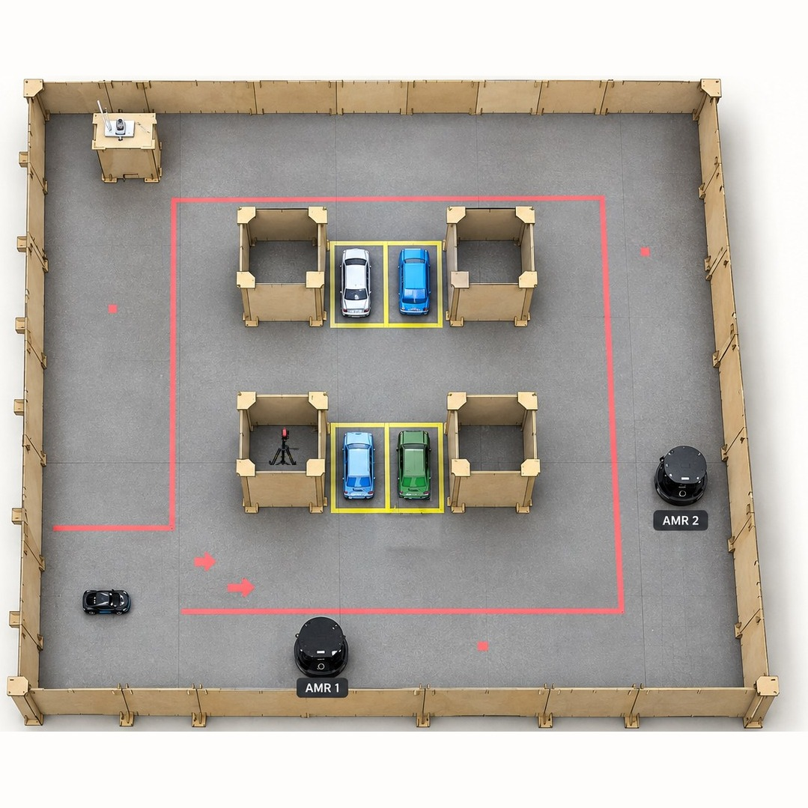
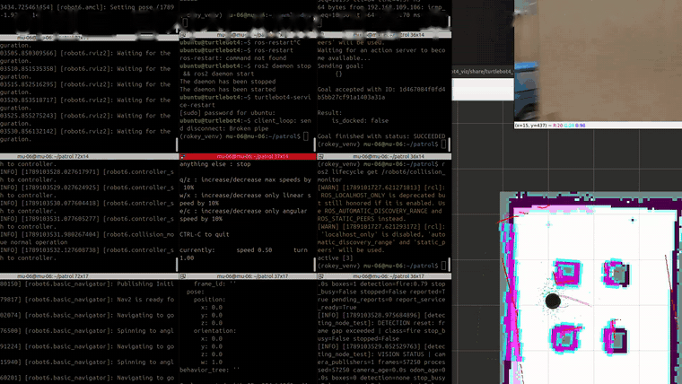
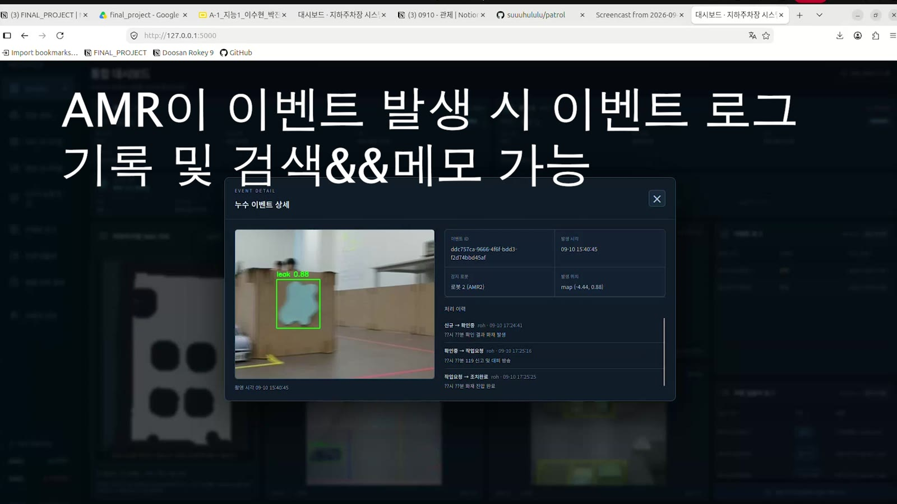
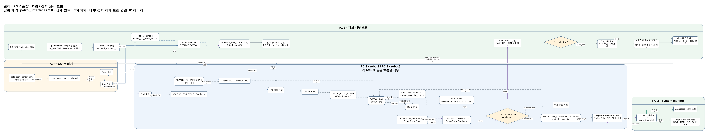
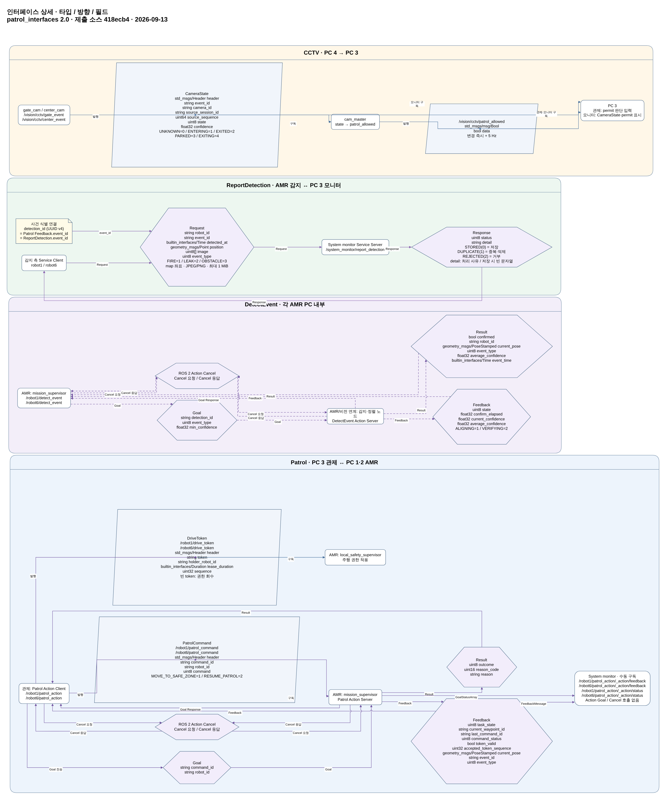
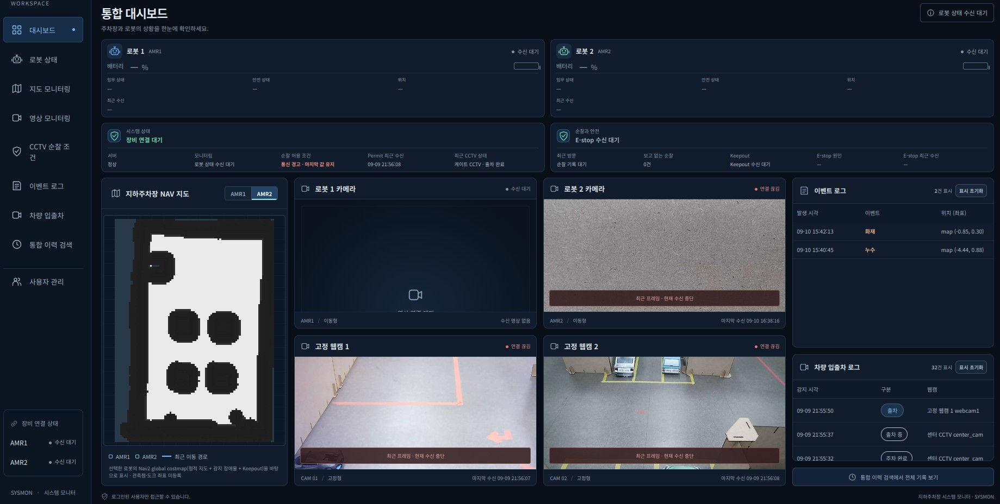
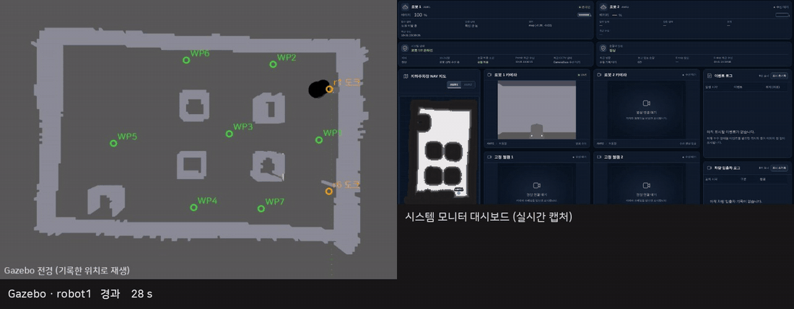

# 🚓 기똥차 — AMR 기반 지하주차장 순찰 시스템

<p align="center">
  
  
  
  
  
  
  
  
  
  
</p>

## 📑 목차

1. [프로젝트 소개](#1-프로젝트-소개)
2. [문제와 목표](#2-문제와-목표)
3. [동작 시나리오](#3-동작-시나리오)
4. [시스템 구조](#4-시스템-구조)
5. [파트별 구현](#5-파트별-구현)
6. [결과](#6-결과)
7. [프로젝트 완료 이후 — Gazebo 통합 검증](#7-프로젝트-완료-이후--gazebo-통합-검증)
8. [트러블슈팅과 배운 점](#8-트러블슈팅과-배운-점)
9. [한계와 개선 방향](#9-한계와-개선-방향)
10. [팀과 역할](#10-팀과-역할)
11. [개발 방식](#11-개발-방식)
12. [실행 방법](#12-실행-방법)
13. [문서와 폴더 구조](#13-문서와-폴더-구조)
14. [라이선스](#14-라이선스)

## 1. 프로젝트 소개

TurtleBot 4 두 대가 교대로 지하주차장을 돌며 화재 · 누수 · 적치물을 찾습니다. 입구와 주차 구역의 CCTV가 차량 움직임을 보고 순찰해도 되는지 정하고, 로봇이 이상을 찾으면 종류 · 위치 · 시각과 사진을 시스템 모니터에 기록합니다.

> 두산 로보틱스 ROKEY Boot Camp 9기 · 지능-1 "SLAM 기반 자율주행 로봇 시스템 구현" · **기똥차** 팀 — 이수현(PM) · 박진용 · 서동권 · 박성현 · 고희태 · 조정묵 · 이영훈 · 노홍동 · 멘토 Andy Kim (이한혁 중도 하차) · 2026.09.04 ~ 09.11(8일)

### ▶ 1분 시연 영상

https://github.com/user-attachments/assets/c60197ef-d87e-4d44-82f0-a03078c54a2f

정상 순찰(웨이포인트 이동, 회전 관측, 도킹 복귀), 차량 진입 시 안전구역 대기와 주차 후 재개, 이벤트 기록과 조회, 이상 감지 후 정지와 재개를 차례로 담았습니다.

## 2. 문제와 목표

| 문제 | 목표 |
|---|---|
| 2018년부터 2022년 9월까지 전국 지하주차장 화재는 296건, 재산 피해는 약 291억 원이었습니다(소방청 국회 제출자료 인용 보도). 초기 확인이 늦으면 피해가 커집니다 | 로봇이 정해진 경로를 반복해 돌며 화재 · 누수 · 적치물을 찾고, 보이면 그 자리에서 멈춰 확인한 뒤 기록합니다 |
| 누수 취약부는 반복 관측과 이력이 있어야 보수 판단을 할 수 있습니다 | 이벤트의 종류 · 위치 · 시각 · 사진을 저장하고 이력으로 조회합니다 |
| 차량이 드나드는 공간이라 로봇이 아무 때나 다니면 위험합니다 | CCTV가 차량 상태를 판정해 순찰 허용 여부를 정하고, 차량이 움직이는 동안 로봇을 안전구역으로 피하게 합니다 |
| 사람이 반복해서 순찰하면 시간이 많이 듭니다 | 관제가 두 로봇을 교대로 출발시키고, 주행 권한과 비상정지를 한곳에서 관리합니다 |

## 3. 동작 시나리오

<p align="center">
  <br>
  <sub>시연 환경 평면도 — 노란 선은 주차 구역, 분홍 선은 안전구역 표시입니다(발표 자료).</sub>
</p>

### 3.1 교대 순찰

1. 관제가 차례인 로봇에 순찰 요청(`Patrol` Action)을 보냅니다. CCTV가 순찰을 허용하고, 다른 로봇이 순찰 중이 아니며, 배터리가 30% 이상이고, 비상정지나 화재 보류가 걸려 있지 않을 때만 보냅니다.
2. 로봇은 주행 권한(`DriveToken`)을 받은 뒤에만 출발합니다. 권한은 한 번에 한 대만 받습니다.
3. 언도킹하고 초기 위치를 잡은 뒤 WP1 ~ WP6 → WP3 → WP7 → WP1 순으로 8자 경로를 돌며, 지점마다 제자리에서 한 바퀴 돌아 주변을 살핍니다.
4. 자기 도크로 돌아와 도킹합니다. 도크 접속이 2초 유지되고 충전이 확인되어야 성공이며, 실패하면 최대 3번까지 다시 시도합니다.
5. 도킹이 끝나면 관제가 권한을 회수하고 다음 로봇을 내보냅니다. `robot1`과 `robot6`이 번갈아 나갑니다.

### 3.2 이상 감지 대응

1. 로봇 카메라(OAK-D)에서 화재 · 누수 · 적치물 후보(신뢰도 0.70 이상)가 보이면 순찰을 멈춥니다.
2. 제자리 회전으로 대상을 화면 가운데에 맞추고(화면 폭 기준 가로 오차 ±0.05 이내를 0.5초 유지), 1초 동안 신뢰도 0.70 이상이 유지되는지 다시 확인합니다.
3. 확정되면 관제에 이벤트를 알리고, 종류 · 위치 · 시각과 증거 사진을 시스템 모니터에 저장합니다.
4. 저장 응답을 받으면 멈췄던 단계부터 순찰을 이어 갑니다.

<p align="center">
  <br>
  <sub>이벤트 감지 → 순찰 정지 → 재개 (터미널 로그와 지도, 시연 1.5배속)</sub>
</p>

<p align="center">
  <br>
  <sub>저장된 이벤트 — AMR이 감지한 누수(leak 0.88)의 증거 사진, 로봇, 위치, 처리 이력</sub>
</p>

### 3.3 차량 출입 대응

| 차량 상태 | 판정 카메라 | 순찰 허용 | 로봇 |
|---|---|---|---|
| `ENTERING` 입차 중 | Gate | `false` | 멈추고 가장 가까운 안전구역으로 이동해 대기 |
| `PARKED` 주차 완료 | Center | `true` | 멈췄던 단계부터 순찰 재개 |
| `EXITING` 출차 중 | Center | `false` | 안전구역으로 이동해 대기 |
| `EXITED` 출차 완료 | Gate | `true` | 순찰 재개 |

<p align="center">
  <br>
  <sub>차량 진입 → 안전구역 이동 명령, 주차 완료 → 순찰 재개 명령 (대시보드 · 관제 터미널, 시연 3배속)</sub>
</p>

### 3.4 비상정지 · 주행 권한 · 배터리

- 비상정지(EStop): 운영자가 걸면 대상 로봇이 즉시 멈추고 진행 중인 주행 · 도킹 · 감지를 취소합니다. 해제만으로는 움직이지 않고, 운영자가 재개 명령을 보내야 이어서 순찰합니다.
- 주행 권한: 관제가 보내는 권한이 끊기면 로봇은 바로 멈추고 기다립니다. 30초 안에 권한이 다시 들어오면 이어서 가고, 그렇지 않으면 임무를 끝냅니다.
- 배터리: 순찰 중 15% 아래로 떨어지면 귀환해 도킹합니다. 관제는 30% 아래로 내려간 로봇을 80%까지 충전될 때까지 내보내지 않습니다.

## 4. 시스템 구조

### 4.1 장비와 PC 구성

| 장비 | 수량 | 용도 |
|---|---|---|
| TurtleBot 4 (OAK-D) | 2 (`robot1` · `robot6`) | 순찰 · 회전 관측 · 이상 감지 · 도킹 |
| 웹캠 | 2 (Gate · Center) | 입출차 · 주차 판정 |
| RC 카 | 1 | 진입 · 주차 시연 차량 |

| PC | 역할 | 실행하는 것 |
|---|---|---|
| PC 1 | AMR 1 (`robot1`) | `mission_supervisor` · `local_safety_supervisor` · 감지 노드, Nav2 · AMCL |
| PC 2 | AMR 2 (`robot6`) | PC 1과 같은 구성 |
| PC 3 | 관제 · 시스템 모니터 | 관제 노드, 시스템 모니터(저장 · 대시보드 · `ReportDetection` 서버) |
| PC 4 | CCTV 비전 | `gate_cam` · `center_cam` · `cam_master` |

모든 PC는 `ROS_DOMAIN_ID=6`, Fast DDS Discovery Server, 같은 `map` 좌표계를 씁니다. 지도 원점은 `robot1` 도크 앞이고, `robot6` 도크 앞은 WP1을 사이에 두고 대칭인 (0, −2.076)입니다. 두 곳 모두 WP1에서 1.06 m 떨어져 있습니다.

### 4.2 시스템 설계도

팀이 작성한 설계도입니다. 그림에 있는 노드 · 토픽 · 서비스 이름은 코드와 같고, 그림을 누르면 원본 크기로 열립니다.

<p align="center">
  <a href="docs/images/design/system_design_01.png"></a><br>
  <sub>시스템 설계도 01 — PC별 통합 연결도. 위는 PC 3(관제, 시스템 모니터), 가운데는 공용 통신, 아래는 PC 1 · PC 2(AMR)와 PC 4(CCTV)입니다.</sub>
</p>

<p align="center">
  <a href="docs/images/design/system_design_02.png"></a><br>
  <sub>시스템 설계도 02 — 관제 판단, AMR 공통 흐름, CCTV, 시스템 모니터의 수행 흐름.</sub>
</p>

### 4.3 통신 인터페이스

공용 계약은 `patrol_interfaces` 패키지이고, 기준 문서는 [docs/interfaces.md](docs/interfaces.md)입니다. 최종 속도 후보 토픽(`cmd_vel_safety_in` · `cmd_vel_yaw`)과 운영 서비스(`/control/*`)는 설계도를 만든 뒤 추가해서 그림에는 없습니다.

| 방식 | 인터페이스 | 송신 → 수신 | 역할 |
|---|---|---|---|
| Topic | `/vision/cctv/gate_event` · `/vision/cctv/center_event` (`CameraState`) | gate_cam · center_cam → cam_master | 차량 상태 이벤트 |
| Topic | `/vision/cctv/patrol_allowed` (`Bool`) | cam_master → 관제 | 순찰 허용 여부(5 Hz) |
| Action | `/{robot}/patrol_action` (`Patrol`) | 관제 → `mission_supervisor` | 순찰 시작 · 진행 · 결과 · 취소 |
| Topic | `/{robot}/drive_token` (`DriveToken`) | 관제 → AMR | 주행 권한(5 Hz, lease 1초) |
| Topic | `/{robot}/patrol_command` (`PatrolCommand`) | 관제 → `mission_supervisor` | 안전구역 이동 · 순찰 재개 |
| Topic | `/control/estop` (`EStop`) | 관제 → AMR · 시스템 모니터 | 비상정지 상태 |
| Service · Topic | `/{robot}/patrol_stop` (`SetBool`) · `/{robot}/patrol_resume` (`Bool`) | 감지 노드 → `mission_supervisor` | 후보 발견 시 정지, 저장 후 재개 |
| Action | `/{robot}/detect_event` (`DetectEvent`) | `mission_supervisor` → 감지 노드 | 정렬 · 확인 요청과 결과 |
| Topic | `cmd_vel_safety_in` · `cmd_vel_yaw` → `cmd_vel` | Nav2 · 감지 노드 → `local_safety_supervisor` → 구동부 | 주행 후보와 최종 속도 |
| Service | `/system_monitor/report_detection` (`ReportDetection`) | 감지 노드 → 시스템 모니터 | 확정 이벤트와 증거 사진 저장 |

<details>
<summary>시스템 설계도 03 — 인터페이스 상세(타입 · 방향 · 필드)</summary>

<p align="center">
  <a href="docs/images/design/system_design_03.png"></a>
</p>

</details>

## 5. 파트별 구현

### 5.1 CCTV 비전 — 차량 상태 판정과 순찰 허용

Gate는 차량 bbox 중심이 두 판정선을 어떤 순서로 넘는지 보고 입차(`ENTERING`)와 출차 완료(`EXITED`)를 판정합니다. Center는 주차 ROI에 5초 머물면 주차(`PARKED`), ROI를 벗어나면 출차 중(`EXITING`)으로 판정합니다. 이동 상태는 0.2초 연속 관측해야 확정하고, 이벤트 사이에는 2초 쿨다운을 둡니다([`gate_cam.py`](src/patrol_vision/patrol_vision/gate_cam.py) · [`center_cam.py`](src/patrol_vision/patrol_vision/center_cam.py)).

`cam_master`는 카메라별 허용 상태인지, 신뢰도가 0 ~ 1 범위인지, 중복 · 역순 이벤트가 아닌지 검사해 모두 통과한 이벤트로만 `patrol_allowed`를 바꿉니다. 이벤트가 끊겨도 값을 임의로 바꾸지 않고, 마지막 값을 5 Hz로 계속 발행합니다([`cam_master.py`](src/patrol_vision/patrol_vision/cam_master.py)).

### 5.2 관제

관제는 두 로봇을 교대로 출발시키고 주행 권한(`DriveToken`), 실행 중 명령(`PatrolCommand`), 비상정지(`EStop`)를 맡습니다([`control_core.py`](src/patrol_control/patrol_control/control_core.py) · [`patrol_control_node.py`](src/patrol_control/patrol_control/patrol_control_node.py)).

- 한 로봇이 도킹을 마치면 다음 로봇을 출발시킵니다. 도킹에 실패한 로봇은 교대에서 빼고 남은 로봇으로 이어 갑니다.
- 화재가 확정되면 `fire_hold`로 다음 순찰을 막고, 운영자가 풀 때까지 기다립니다.
- 관제를 다시 띄우면 저장해 둔 상태를 불러오고, AMR에 남은 임무가 있으면 취소한 뒤 취소가 끝날 때까지 새 순찰을 내보내지 않습니다.
- 운영 명령은 터미널 ROS 서비스로 받습니다: `/control/start_patrol` · `cancel_patrol` · `clear_fire_hold` · `set_estop` · `resume`.

### 5.3 AMR — 순찰 임무 · 주행 안전 · 이상 감지

- **순찰 임무(`mission_supervisor`):** 관제가 보내는 `Patrol` Action을 받는 서버로, 권한 대기부터 언도킹, 순찰, 귀환과 도킹까지 맡습니다. 비상정지와 권한 끊김은 어느 단계에서든 바로 처리합니다. 안전구역 명령은 언도킹 · 도킹 중이면 그 동작을 마친 뒤 따르고, 감지 노드의 정지 요청은 순찰 경로를 달릴 때만 받습니다. 웨이포인트에 가지 못하면 한 번 더 시도한 뒤 건너뛰고, 두 곳을 연달아 건너뛰면 귀환합니다. 경로 · 도크 · 안전구역 좌표는 [`config/site.yaml`](src/patrol_amr_safety/config/site.yaml)에서 읽습니다([`mission_supervisor.py`](src/patrol_amr_safety/patrol_amr_safety/mission_supervisor.py)).
- **주행 안전(`local_safety_supervisor`):** 바퀴로 가는 최종 속도는 이 노드 하나만 냅니다. Nav2 주행 후보와 정렬 회전 후보 가운데 최근 0.5초 안에 들어온 것이 정확히 하나이고, 주행 권한이 유효하며 비상정지 상태가 아닐 때만 그 속도를 내보냅니다. 두 후보가 겹치거나 권한 · 비상정지 조건이 맞지 않으면 0을 냅니다([`local_safety_supervisor.py`](src/patrol_amr_safety/patrol_amr_safety/local_safety_supervisor.py)).
- **이상 감지(감지 노드):** YOLO11n으로 후보를 찾고, `DetectEvent` 요청을 받으면 정렬 회전과 1초 확인을 한 뒤 `ReportDetection`으로 저장합니다. 증거 사진은 1 MiB 안으로 맞춰 보내고, 저장에 실패한 보고는 사진과 내용을 로봇 PC에 따로 남깁니다([`vision_node_v2.py`](src/patrol_amr_safety/patrol_amr_safety/vision_node_v2.py) · [`event_check.py`](src/patrol_amr_safety/patrol_amr_safety/event_check.py)).

### 5.4 시스템 모니터

로봇 상태, 차량 로그, 감지 이벤트와 증거 사진, 순찰 이력을 SQLite와 이미지 파일로 저장하고, 대시보드(지도, 4분할 영상, 최근 로그)와 이력 조회를 제공합니다. `ReportDetection` 서비스 서버도 맡습니다. 대시보드는 로봇을 조작하지 않는 읽기 전용 화면이고, 이벤트 처리 같은 관리자 기능은 로그인 · 세션 · CSRF와 서버 측 권한 검사로 보호합니다([`src/patrol_sysmon`](src/patrol_sysmon/README.md)).

<p align="center">
  <br>
  <sub>통합 대시보드 — 로봇 상태, 지도, 로봇 카메라 · CCTV 4분할 영상, 이벤트 로그(화재 · 누수)와 차량 입출차 로그</sub>
</p>

## 6. 결과

### 6.1 시연 결과

| 장면 | 결과 | 근거 |
|---|---|---|
| 정상 순찰 · 도킹 | 웨이포인트 이동과 회전 관측 후 복귀 · 도킹 | 시연 영상 |
| 차량 출입 대응 | Gate · Center 판정이 `patrol_allowed`를 거쳐 관제 명령으로 이어짐. 차량 진입 시 안전구역 대기, 주차 후 재개, 시스템 모니터 차량 로그에 기록 | 시연 영상 · 관제 터미널 |
| 이상 감지와 기록 | 순찰 중 화재 · 누수 감지 → 정지 → 시스템 모니터에 로그와 사진 | 시연 영상 |

### 6.2 비전 모델 성능

| 모델 | 결과 | 근거 |
|---|---|---|
| 차량 검출(CCTV) | YOLO11n · Test P 0.987 · R 0.988 · mAP50-95 0.696 (yolov8n · yolo11n · yolo26n 중 Recall 우선 선정) | [차량 모델 선정 보고서](data/car_data/latest_model_selection_report.md) |
| 이상 감지(AMR) | YOLO11n · Test P 0.967 · R 0.997 · mAP50-95 0.700 (후보 6종 중 화재 · 누수 Recall 우선 선정) | [감지 모델 선정 보고서](data/detection_data/latest_model_selection_report.md) |

위 수치는 모델 선정 단계 기준이고, 실제로 쓴 차량 모델은 시연 환경 이미지를 더해 다시 학습한 `car_best_v2`입니다. 수치는 Colab에서 잰 값이라 로봇 PC에서의 실시간 성능과는 다를 수 있습니다.

<details>
<summary>이상 감지 후보 모델 6종 비교</summary>

<p align="center">
  <br>
  <sub>Validation 기준 클래스별 Recall · mAP · Colab 추론 시간 · 모델 크기. 화재 · 누수 Recall을 먼저 보고 yolo11n을 선정했습니다.</sub>
</p>

</details>

### 6.3 테스트

| 패키지 | 결과 | 다루는 내용 |
|---|---|---|
| CCTV(`patrol_vision`) | 4개 통과 | CameraState 계약 · 허용 상태, 코드 스타일 |
| 관제(`patrol_control`) | 49개 통과 | 교대 · 권한 · 차량 명령 · 화재 보류 · 비상정지 · 배터리 · 재시작 복구, 코드 스타일 |
| AMR(`patrol_amr_safety`) | 92개 통과 | 순찰 흐름 전체(모의 Nav2 · Create 3 · 가상 시계), 주행 안전 판정, 정렬 · 보고, 현장 좌표, 코드 스타일 |
| 시스템 모니터(`patrol_sysmon`) | 129개 통과 | 저장 · 중복 · 거부, 화면 · 권한, ROS 수신 |

프로젝트를 마친 뒤에는 Gazebo에서 전체 시스템을 한 번에 연결해 다시 돌려 보았습니다([7절](#7-프로젝트-완료-이후--gazebo-통합-검증)).

## 7. 프로젝트 완료 이후 — Gazebo 통합 검증

Gazebo의 TurtleBot 4를 AMR로 쓰고, CCTV(`cam_master`) · 관제 · 시스템 모니터와 AMR 노드를 이 저장소 코드 그대로 연결해 전체 시스템을 돌려 보았습니다. 시간값은 느린 시뮬레이션 속도에 맞춰 늘렸고, CCTV 차량 상태와 충전 상태는 같은 형식의 메시지로 넣었습니다(아래 "시뮬레이션 환경과 조정값").

| 구성 | 실행한 것 |
|---|---|
| CCTV | `cam_master`(입력은 `CameraState` 이벤트) |
| 관제 | 관제 노드, 운영 서비스(`/control/set_estop` · `/control/resume`) |
| AMR | Gazebo TurtleBot 4(`robot1`, Create 3 도킹 포함) · AMCL · Nav2, `mission_supervisor` · `local_safety_supervisor` · 감지 노드 |
| 시스템 모니터 | ROS 어댑터(저장 · `ReportDetection` 서버) · 대시보드 |
| 지도 · 월드 | 시연장 지도 [`maps/final_project_map`](maps/)의 벽 · 장애물을 세운 월드(월드 좌표 = 지도 좌표)와 누수 표지 |

### 7.1 한 대 전체 순찰 — 차량 대응 · 비상정지 · 감지 저장

<p align="center">
  <br>
  <sub>왼쪽: Gazebo(실행 중 기록한 위치로 다시 렌더링, 주황 선은 지나온 경로) · 오른쪽: 시스템 모니터 대시보드(실행 중 캡처) · 아래: 진행 중인 장면 (약 90배속, 도크 앞 도착까지)</sub>
</p>

| 장면 | 연결 | 결과 |
|---|---|---|
| 순찰 경로 | 관제 → `Patrol` → AMR | WP1 ~ WP6 → WP3 → WP7 → WP1, 9곳 도착 · 지점마다 360° 회전. 대시보드에 위치 · 방문 이력 9건 |
| 입차 → 주차 | CCTV 이벤트 → `cam_master` → 관제 → `PatrolCommand` → AMR | WP2 도착 뒤 입차 이벤트를 보내자 `patrol_allowed`가 false가 되어 가장 가까운 안전구역에서 대기했고, 주차 이벤트로 true가 되자 멈춘 단계부터 재개함 |
| 비상정지 | 운영 서비스 → 관제 → `EStop` → AMR | WP3 도착 뒤 비상정지를 걸자 멈추고 `BLOCKED`가 됨. 해제한 뒤에도 재개 명령 전까지 제자리에 있었고(Gazebo 실제 위치 기준), 재개 명령 뒤 순찰을 이어 감 |
| 출차 중 → 출차 완료 | CCTV 이벤트 → `cam_master` → 관제 → AMR | WP5 도착 뒤 출차 중 이벤트로 안전구역에서 대기했고, 출차 완료 이벤트로 순찰을 이어 감 |
| 감지 → 저장 | AMR → 감지 노드 → `ReportDetection` → 시스템 모니터 | WP3 재방문 지점에서 정렬한 뒤 누수로 확정(평균 신뢰도 0.81)해 `STORED` 응답을 받았고, 대시보드 이벤트 로그에 이벤트와 증거 사진이 올라옴. 이후 순찰을 이어 감 |
| 귀환 | 관제 → `Patrol` → AMR | 마지막 WP1 회전 뒤 robot1 도크 앞 (0, 0)으로 귀환 |

시스템 모니터 DB에는 이 실행의 이벤트 1건 · 증거 사진 1장, CCTV 상태 이벤트 4건, 차량 입출차 기록, 순찰 방문 9건, 비상정지 이력이 저장됐습니다.

### 7.2 교대 순찰 흐름 — robot1 ↔ robot6

교대는 관제 노드가 Action 결과를 받으면 다음 로봇을 출발시키는 방식입니다.

1. robot1의 `Patrol` 결과(`docked` 또는 도킹 실패)를 받습니다.
2. robot1의 주행 권한을 회수합니다(빈 `DriveToken`).
3. 다음 로봇을 고를 때 출발 조건(순찰 허용, 배터리, 비상정지, 화재 보류)을 확인합니다.
4. `/robot6/patrol_action`에 Goal을 보내고, robot6이 `WAITING_FOR_TOKEN`을 알리면 robot6에만 `DriveToken`을 줍니다.
5. robot6은 자기 도크에서 언도킹해 같은 경로를 돌고 자기 도크로 돌아옵니다. 두 로봇은 도크 좌표만 다르고 코드와 경로 설정은 같습니다([`config/site.yaml`](src/patrol_amr_safety/config/site.yaml)).

### 7.3 통합하면서 보완한 것

- 도킹 재시도: 이전 시도가 끝나기 전에 다시 보내면 Create 3가 새 요청을 거부해서, 이전 시도를 취소하고 끝날 때까지(최대 5초) 기다린 뒤 다시 보내도록 바꿨습니다.
- 정지 확인: odometry가 늦게 들어와 정지 확인에 실패하면 다시 확인하고, 3번 연달아 실패하면 `BLOCKED`로 기다리다가 정지가 확인되면 이어서 가도록 했습니다.

두 항목 모두 AMR 테스트에 추가했습니다.

<details>
<summary>시뮬레이션 환경과 조정값</summary>

작업 PC(CPU 2코어)에서 Gazebo · Nav2 · YOLO를 함께 돌리면 시뮬레이션이 실시간보다 느리고 카메라 처리가 초당 약 0.7장입니다. 시뮬레이션만을 위해 코드를 고치지는 않았고, 아래 값과 보조 스크립트만 따로 썼습니다.

| 항목 | 실제 장비 | Gazebo | 이유 |
|---|---|---|---|
| DriveToken lease | 1초 | 3초 | 느린 시뮬레이션에서 토큰 수신 간격이 1초를 넘음 |
| 감지 노드 시간 기준(프레임 간격 · 후보 간격 · 정렬 유지 · 정렬 제한 · 검증 제한) | 0.3 · 0.6 · 0.5 · 10 · 6초 | 4 · 6 · 2 · 70 · 40초 | 카메라 처리 속도. 신뢰도 0.70, 정렬 허용 오차 0.05, 회전 속도는 그대로 |
| 감지 노드의 정지 확인 odometry 유효시간 | 0.5초 | 1초 | 느린 odometry 수신 |
| Nav2 시간 여유 | 저장소 `nav2.yaml` | 제어 주기 10 Hz, TF 허용 1초, 진행 판정 40초 등 | 느린 시뮬레이션 시계에서 시간 초과 방지 |
| 카메라 압축 영상 | OAK-D 드라이버 | Gazebo 영상을 JPEG로 다시 발행 | 시뮬레이션 카메라는 원본 영상만 냄 |
| 충전 상태 | Create 3가 보고 | 도킹 중이면 충전 중으로 다시 발행 | Gazebo의 Create 3는 충전 상태를 보내지 않음 |
| CCTV 차량 상태 | `gate_cam` · `center_cam`(YOLO 판정) | 같은 형식의 `CameraState` 이벤트를 같은 토픽에 발행 | Gazebo에 차량 영상이 없음 |
| 전경 화면 | — | 실행 중 기록한 위치(AMCL)로 실행이 끝난 뒤 같은 월드에서 다시 렌더링. AMCL과 Gazebo 실제 위치의 차이는 평균 약 8 cm | 실행 중 전경 카메라까지 렌더링하면 CPU가 부족함 |

</details>

## 8. 트러블슈팅과 배운 점

### 8.1 트러블슈팅

| 문제 | 원인 | 어떻게 해결했나 | 결과 |
|---|---|---|---|
| AMR 통합이 늦어져 전체 일정이 밀림 | 순찰 명령과 상태를 여러 토픽으로 나눠 보내 팀 간 계약이 계속 바뀜 | 하나의 작업으로 볼 기능은 Action · Service로 묶고, 계속 갱신되는 정보(`DriveToken`, CCTV 상태)만 토픽으로 남겨 `patrol_interfaces`로 정리 | 팀 간 계약이 한 패키지로 고정되고, 이후 변경은 CR로만 진행 |
| 감지 결과와 증거 사진을 여러 토픽으로 보내면 순서 · 재전송 · 회신 관리가 복잡함 | 이벤트 · 사진 조각 · 수신 회신을 각각 토픽으로 설계 | 사진을 요청에 담는 `ReportDetection` 서비스 한 번으로 바꾸고, 응답(저장 · 중복 · 거부)을 저장 결과로 사용 | 감지 노드는 응답이 없을 때만 같은 이벤트 ID로 다시 보내면 됨 |
| 정렬 회전과 Nav2가 동시에 바퀴 명령을 내면 어느 쪽을 따를지 모호함 | 두 노드가 각자 속도 명령을 냄 | 최종 속도는 `local_safety_supervisor` 하나만 내고, 0.5초 안에 받은 후보가 정확히 하나일 때만 통과 | 바퀴 명령을 내는 노드가 하나로 정리됨(정렬 전에 정지를 확인하므로 평소에는 두 후보가 겹치지 않음) |
| 대시보드가 길어지고 영상이 작아짐, 로그가 늘면 배치가 흔들림 | 정보를 세로로 나열한 화면 구조 | 상단 상태 요약 + 하단 지도 · 4분할 영상 · 최근 로그, 로그 영역 내부 스크롤, 화면 폭에 따라 3열 → 2열 → 1열 | 현재 상태와 현장을 한 화면에서 확인 |
| 누구나 관리자 기능에 접근할 수 있음 | 대시보드에 인증이 없음 | 로그인 · 세션 · CSRF와 서버 측 권한 검사, 관리자 계정은 명령으로만 생성 | 관리자 기능 접근 제한 |

### 8.2 배운 점

- 상태 이름만 맞추고 발생 조건과 판단 주체는 정하지 않았더니, 같은 "정지"도 팀마다 다르게 구현했습니다. 이후로는 누가, 어떤 조건에서 상태를 바꾸는지까지 함께 정했습니다.
- 진척은 실행 로그 · 영상 · 저장 이력으로 확인했고, 막힌 부분은 바로 공유해 업무를 다시 나누고 경험자가 돕는 방식으로 바꿨습니다.

## 9. 한계와 개선 방향

### 9.1 한계

- EStop은 ROS 메시지로 멈추는 소프트웨어 정지라 하드웨어 비상정지를 대신하지 못합니다. 관제와의 연결이 끊기면 주행 권한 만료(1초)나 EStop 수신 끊김(3초)으로 멈춥니다.
- 운영 명령은 터미널의 ROS 서비스로만 보냅니다. 대시보드에서는 로봇을 조작할 수 없습니다.
- 언도킹 직후 초기 위치를 도크 좌표로 넣기 때문에 로봇은 자기 도크에서 출발해야 합니다.
- Center의 주차 판정은 bbox 중심점 기준이고, 차량은 1대만 있다고 보고 신뢰도가 가장 높은 박스 하나만 씁니다.
- 카메라 장애를 관제나 시스템 모니터에 알리지 못하고, 프레임을 3초 연속 못 읽으면 로그만 남깁니다. `cam_master`를 다시 띄우면 `patrol_allowed`가 true로 초기화됩니다.
- 화재 · 누수는 모형 촛불과 색지로 재현했고, 차량은 RC 카 1대로 시연했습니다.

### 9.2 개선 방향

- Gazebo 통합 시나리오(차량 대응, 비상정지, 교대)를 TurtleBot 4 두 대로 반복 실행
- 하드웨어 비상정지와 소프트웨어 EStop의 연동, 카메라 장애의 관제 전달

## 10. 팀과 역할

| 파트 | 담당 | 맡은 것 | 상세 문서 |
|---|---|---|---|
| PM | 이수현 | 요구사항 · 개발 진행 기준 정리, 일정 · 협업 조율 | [scenarios.md](docs/scenarios.md) |
| 비전 | 박진용 · 서동권 | 차량 상태 판정(Gate 선 통과 · Center ROI 체류) · `cam_master`의 `patrol_allowed` 변환 · 카메라 통합, 모델 학습 · 위험 이벤트 탐지 | [vision.md](docs/vision.md) |
| 관제 · 통합 | 고희태 | 임무 · 주행 권한 관리, 차량 대응 · 출동 로봇 선택 · 팀 간 연동 | [control_server.md](docs/control_server.md) |
| AMR | 조정묵 · 박성현 | 주행 · 안전 · 상태 관리, 관측 · 대피 · 재개 · 도킹 | [amr.md](docs/amr.md) |
| 시스템 모니터 | 노홍동 · 이영훈 | ROS 어댑터 · 데이터 저장, 대시보드 표시 · 순찰 이력 조회 | [monitoring_and_data.md](docs/monitoring_and_data.md) |

## 11. 개발 방식

8일 동안 비전 · 관제 · AMR · 시스템 모니터 네 개발 단위가 `patrol_interfaces` 한 패키지를 공용 계약으로 함께 쓰며 개발했습니다. 계약을 바꿀 때는 변경 요청서(CR)를 쓰고, 결정은 결정 기록으로 남겼습니다.

<details>
<summary>계약 · 기록 · 브랜치 규칙</summary>

- **공용 계약:** `patrol_interfaces` — 모든 PC가 같은 커밋의 인터페이스 패키지를 빌드하고 해시를 비교합니다.
- **설계도:** 시스템 설계도(PC별 연결도 · 수행 흐름 · 인터페이스 상세)와 CCTV · AMR 감지 노드 설계도를 draw.io로 작성했습니다.
- **변경 요청서(CR) 10건:** QoS 확정, 정지 서비스 · 재개 토픽, Action 중심 계약 전환 등 팀 간 계약 변경을 요청 · 승인 단위로 기록했습니다.
- **결정 기록 4건:** 설계 기준선, 관제 인터페이스, AMR 명령 · 임무 계약, 감지 인터페이스.
- **단계별 통과 기준:** 단위 개발(입출력 · 실패 · 대기 확인, 실행 로그) → 부분 통합(송수신 값 · 필드 · enum 대조, 양쪽 연결 로그) → 전체 통합(순찰 · 중단 · 재개 · 도킹 · 교대 결과, 영상과 이력).
- **브랜치 · PR:** `main`과 짧은 작업 브랜치로 협업하고, 다른 PC와 맞물리는 변경은 PR로 확인받았습니다([branch-guide](docs/development/branch-guide.md) · [pull-request-guide](docs/development/pull-request-guide.md) · [version-control](docs/development/version-control.md)).
- **협업 도구:** Git/GitHub · Notion · Google Drive · draw.io

</details>

## 12. 실행 방법

ROS 없이 시스템 모니터만 띄우거나, ROS 2 환경에서 빌드 · 테스트하거나, 장비 전체를 실행하는 방법입니다.

<details>
<summary>개발 환경</summary>

| 항목 | 값 |
|---|---|
| OS · 미들웨어 | Ubuntu 24.04 · ROS 2 Jazzy · Fast DDS(Discovery Server) · `ROS_DOMAIN_ID=6` |
| 주행 | TurtleBot 4 Navigator · Nav2 · AMCL · Create 3 Dock/Undock · `map` 좌표계 |
| 비전 | Ultralytics YOLO11n · OpenCV · OAK-D(AMR) · 웹캠(Gate · Center) |
| 저장 · 화면 | Flask · SQLite · 이미지 파일 · 읽기 전용 대시보드(로그인 · 세션) |
| 언어 · 도구 | Python 3.12 · colcon · pytest · flake8 · pep257 · Git/GitHub · draw.io |

</details>

<details>
<summary>빠른 시작 — 시스템 모니터 실행과 테스트 (ROS 불필요)</summary>

```bash
git clone https://github.com/abyssGo/AMR-patrol-system.git
cd AMR-patrol-system/src/patrol_sysmon
python3 -m venv .venv
.venv/bin/python -m pip install -r requirements.txt
.venv/bin/python -m unittest discover -s tests    # ROS가 없으면 ROS 수신 테스트 6개는 건너뜀
.venv/bin/python -m flask --app run create-admin   # 최초 1회 관리자 계정 생성
.venv/bin/python run.py                            # http://127.0.0.1:5000
```

</details>

<details>
<summary>빌드와 테스트 (ROS 2 Jazzy 필요, 로봇 · 카메라 불필요)</summary>

```bash
source /opt/ros/jazzy/setup.bash
colcon build
source install/setup.bash
python3 scripts/verify_interface_v1.py                     # 공용 인터페이스 검사
(cd src/patrol_vision && python3 -m pytest -q test)        # CCTV
(cd src/patrol_control && python3 -m pytest -q test)       # 관제
(cd src/patrol_amr_safety && python3 -m pytest -q test)    # AMR
```

</details>

<details>
<summary>전체 실행 (장비 필요)</summary>

모든 PC에서 같은 커밋으로 `colcon build`하고 `ROS_DOMAIN_ID=6`을 맞춥니다. 기동 순서와 점검 항목은 [docs/integration.md](docs/integration.md)를 따릅니다.

```bash
# PC 4 (CCTV 비전)
ros2 launch patrol_vision cctv_cam.launch.py

# PC 1 (PC 2는 robot1 → robot6)
ros2 launch turtlebot4_navigation localization.launch.py namespace:=robot1 map:=$PWD/maps/final_project_map.yaml
ros2 launch turtlebot4_navigation nav2.launch.py namespace:=robot1
ros2 launch patrol_amr_safety amr.launch.py robot_id:=robot1

# PC 3 (시스템 모니터 · 관제)
(cd src/patrol_sysmon && .venv/bin/python run.py)    # 대시보드
(cd src/patrol_sysmon && python3 ros_adapter.py)     # ROS 수신 · ReportDetection 서버
ros2 run patrol_control patrol_control_node

# PC 3 운영 명령
ros2 service call /control/start_patrol std_srvs/srv/Trigger
ros2 service call /control/set_estop patrol_interfaces/srv/SetEStop "{target_robot_id: all, active: true, reason: 1}"
ros2 service call /control/set_estop patrol_interfaces/srv/SetEStop "{target_robot_id: all, active: false, reason: 1}"
ros2 service call /control/resume std_srvs/srv/Trigger
```

- **모델 가중치**는 저장소에 없습니다. `gate_cam` · `center_cam`은 `~/patrol/data/car_data/car_best_v2.pt`, 감지 노드는 `~/patrol/detection_best/detection_best.pt`를 읽습니다.
- **현장 좌표**(경로 · 도크 · 안전구역)는 [`src/patrol_amr_safety/config/site.yaml`](src/patrol_amr_safety/config/site.yaml)에 있습니다. 현장이 바뀌면 이 파일만 고칩니다.

</details>

## 13. 문서와 폴더 구조

| 문서 | 내용 |
|---|---|
| [`docs/`](docs/README.md) | 문서 지도 — 설계 · 인터페이스 · 시나리오 · 통합 |
| [`docs/design/`](docs/design/) | 시스템 · CCTV · AMR 감지 노드 설계도 원본(draw.io) |
| [`docs/interfaces.md`](docs/interfaces.md) | Action · 메시지 · 서비스 · 토픽 계약, 운영 서비스 |
| [`docs/scenarios.md`](docs/scenarios.md) | 상황별 시스템 동작 |
| [`docs/architecture.md`](docs/architecture.md) · [`docs/integration.md`](docs/integration.md) | 시스템 구성 · Discovery · 통합 순서와 점검 항목 |
| [`docs/vision.md`](docs/vision.md) · [`docs/control_server.md`](docs/control_server.md) · [`docs/amr.md`](docs/amr.md) · [`docs/monitoring_and_data.md`](docs/monitoring_and_data.md) | 개발 단위별 설계 |
| [`docs/change_requests/`](docs/change_requests/README.md) · [`docs/decisions/`](docs/decisions/) | 변경 요청서 10건 · 결정 기록 4건 |
| [`src/patrol_interfaces`](src/patrol_interfaces/README.md) · [`src/patrol_control`](src/patrol_control/README.md) · [`src/patrol_amr_safety`](src/patrol_amr_safety/README.md) · [`src/patrol_sysmon`](src/patrol_sysmon/README.md) | 패키지별 실행 · 구성 · 테스트 |
| [`data/`](data/) | 차량 · 이상 감지 모델 선정 보고서 |

<details>
<summary>폴더 구조</summary>

```text
AMR-patrol-system/
├── src/
│   ├── patrol_interfaces/      공용 계약 (Patrol Action · 메시지 4종 · 서비스 2종)
│   ├── patrol_amr_interfaces/  AMR 내부 계약 (DetectEvent Action)
│   ├── patrol_amr_safety/      AMR 순찰 · 최종 속도 통제 · 감지 노드, 현장 좌표(config/site.yaml)
│   ├── turtlebot4_navigation/  TurtleBot 4 Navigator · Nav2 · AMCL 설정
│   ├── patrol_control/         관제 노드
│   ├── patrol_vision/          CCTV 차량 비전(gate_cam · center_cam) · cam_master
│   └── patrol_sysmon/          시스템 모니터(Flask · SQLite · 대시보드 · ROS 어댑터)
├── docs/                       설계 · 인터페이스 · 시나리오 · 통합 · CR · 결정 기록 · 설계도(design/) · 이미지(images/)
├── data/                       모델 선정 보고서(car_data · detection_data)
├── maps/                       순찰 지도(final_project_map)
├── scripts/ · .githooks/       인터페이스 검사 · 추적 경로 검사 · 커밋 훅
└── LICENSE
```

</details>

## 14. 라이선스

[Apache License 2.0](LICENSE) — 각 ROS 2 패키지의 `package.xml` · `setup.py`에 선언된 라이선스입니다. Clearpath Robotics의 TurtleBot 4 패키지를 바탕으로 한 `src/turtlebot4_navigation`은 원 저작권 표시를 따릅니다.
