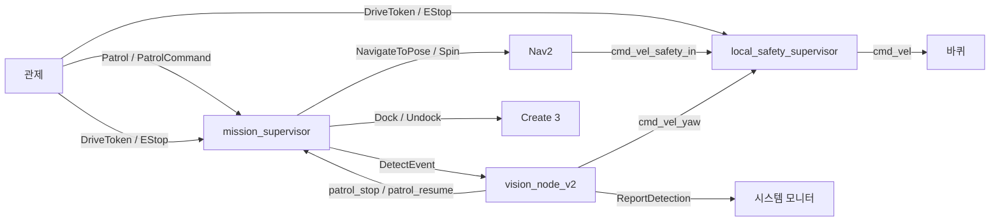
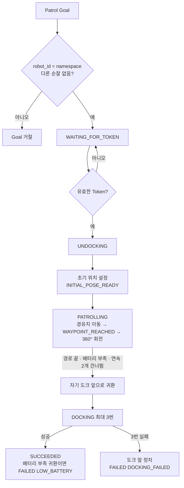
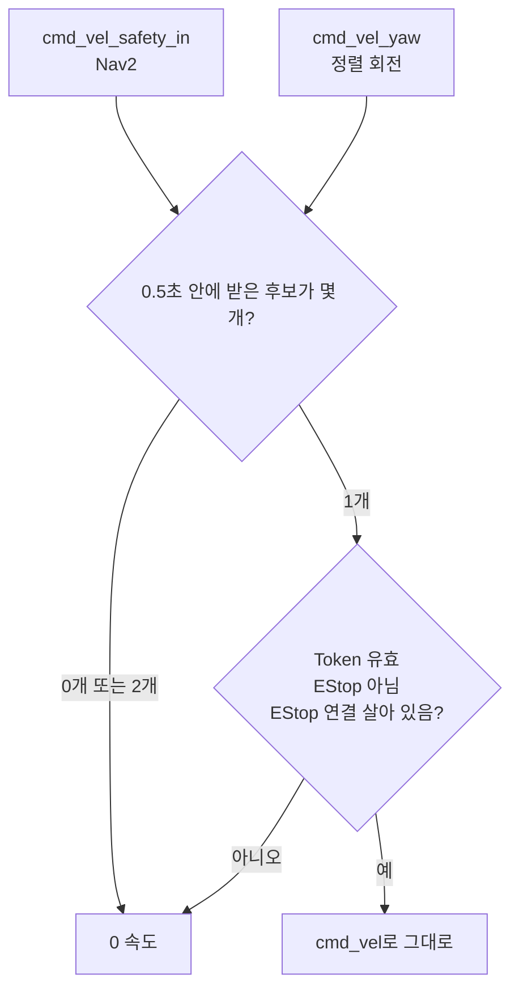
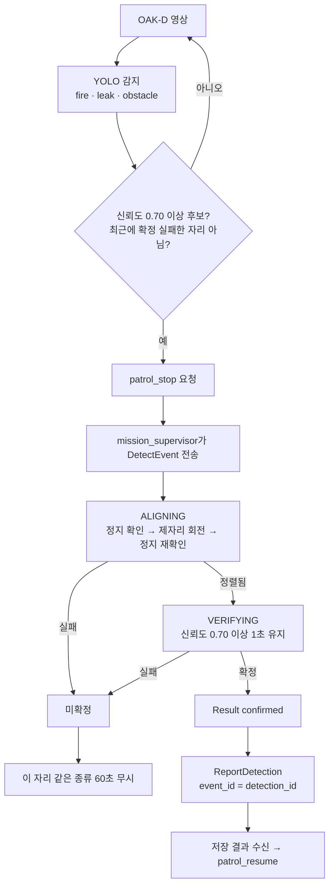

# AMR 기능 설계

> 기준일: 2026-09-13 · 계약: `patrol_interfaces 2.1.0` · 패키지: `patrol_amr_safety`
>
> 실행 위치: PC 1(`robot1`), PC 2(`robot6`)

두 AMR은 같은 노드를 실행하고 namespace(`/robot1`, `/robot6`)로만 구분한다. 공용
필드와 QoS는 [interfaces.md](interfaces.md)를 따른다.

## 1. 책임

AMR이 하는 일:

- `/{robot}/patrol_action` Action Server: Goal 수락, 진행 Feedback, Result
- `PatrolCommand`에 따른 안전구역 이동과 순찰 재개
- DriveToken·EStop 확인과 최종 속도 통제
- Nav2 경유지 주행, Create 3 언도킹·도킹
- 화재·누수·적치물 로컬 감지, 정렬·검증, `ReportDetection` 저장 요청
- 배터리 부족 귀환, 경유지 실패 처리, 도킹 재시도

AMR이 하지 않는 일: 어느 로봇이 순찰할지, 출발해도 되는지, Token 발급, 화재 후 다음
순찰 허용. 이것은 관제가 판단한다. CCTV 차량 상태 처리는 PC 4 비전 담당이다.

## 2. 노드와 연결

| 노드 | 하는 일 |
|---|---|
| `mission_supervisor` | Patrol Action Server. 순찰 경로 실행, 중단 처리, 언도킹·도킹, 감지 노드와 연동 |
| `local_safety_supervisor` | Nav2 후보(`cmd_vel_safety_in`)와 정렬 회전 후보(`cmd_vel_yaw`) 중 하나를 골라, Token과 EStop이 허락할 때만 `cmd_vel`로 냄 |
| `vision_node_v2` | OAK-D 영상 YOLO 감지, 정지 요청, `DetectEvent` 정렬·검증, `ReportDetection` |



Nav2의 `collision_monitor` 출력과 `docking_server` 출력은 `turtlebot4_navigation`
설정에서 `cmd_vel_safety_in`으로 바꿔 두었다. 그래서 `local_safety_supervisor`가 없으면
Nav2 주행이 바퀴에 전달되지 않는다.

## 3. 순찰 흐름 (`mission_supervisor`)



### 3.1 경로와 위치

경로 · 도크 · 안전구역 좌표는 [`config/site.yaml`](../src/patrol_amr_safety/config/site.yaml)에 있다.
현장이나 지도가 바뀌면 이 파일만 고치면 되고, 다른 파일을 쓰려면 `mission_supervisor`의
`site_file` 파라미터로 지정한다. 기본값은 아래와 같다.

경로(두 로봇 공통, `map` 좌표):

| 순서 | 경유지 | 좌표 (x, y) |
|---|---|---|
| 1 | WP1 | (−0.206, −1.038) |
| 2 | WP2 | (−1.147, 0.500) |
| 3 | WP3 | (−2.029, −0.916) |
| 4 | WP4 | (−2.751, −2.422) |
| 5 | WP5 | (−4.389, −1.122) |
| 6 | WP6 | (−2.909, 0.575) |
| 7 | WP3 | (−2.029, −0.916) |
| 8 | WP7 | (−1.374, −2.439) |
| 9 | WP1 | (−0.206, −1.038) |

각 경유지에 도착하면 `WAYPOINT_REACHED`를 보고하고 그 자리에서 360° 회전한다.

| 로봇 | 도크 앞(귀환점) | 언도킹 직후 초기 위치 |
|---|---|---|
| `robot1` | (0, 0), 북쪽 | (0, 0), 남쪽 |
| `robot6` | (0, −2.076), 북쪽 | (0, −2.076), 남쪽 |

두 로봇은 같은 지도(`maps/final_project_map.yaml`)를 쓰며 지도 원점은 `robot1` 도크다.
`robot6` 도크는 같은 벽에서 WP1을 사이에 두고 `robot1` 도크와 대칭인 위치(0, −2.076)에 있다. 두 도크 모두 WP1에서 1.06 m다.

안전구역은 WP1, WP2, WP4, WP5, WP6, WP7 위치 6곳이다(WP3은 제외).
`MOVE_TO_SAFE_ZONE`을 받으면 지금 위치에서 가장 가까운 곳으로 간다.

### 3.2 중단 처리

EStop과 Token 끊김은 모든 대기 구간(주행, 회전, 언도킹, 도킹, 감지, 안전구역 대기)에서 바로 처리한다. `MOVE_TO_SAFE_ZONE`은 언도킹 · 도킹 중에 받으면 그 동작이 끝난 뒤 적용하고, 감지 노드의 `patrol_stop`은 순찰 경로 주행 중에만 받는다.

| 입력 | 동작 | Feedback |
|---|---|---|
| EStop 활성 | 즉시 래치. 주행·회전·도킹·감지 취소, 정지. EStop 해제 + 유효한 Token + 해제 뒤 받은 재개 명령이 모두 있어야 풀림 | `BLOCKED` |
| Token 회수·만료 | 정지. 돌아오면 이어서 진행, 30초 안에 안 돌아오면 `FAILED(TOKEN_EXPIRED)` | `BLOCKED` |
| `MOVE_TO_SAFE_ZONE` | 정지 → 가장 가까운 안전구역 → 대기. 감지 처리 중이어도 감지를 취소하고 간다 | `MOVING_TO_SAFE_ZONE` |
| `RESUME_PATROL` | 멈췄던 단계부터 재개(회전 중이었다면 그 경유지로 돌아가 다시 회전) | `RESUMING` → `PATROLLING` |
| `patrol_stop` (감지 노드) | 순찰 경로 주행 중일 때만 받음. 정지 → `DetectEvent` → 결과에 따라 보고 후 재개 | `DETECTION_PROCESSING` → `DETECTION_CONFIRMED` |
| 경유지 이동 실패 | 1번 더 시도 → 건너뜀(Result `reason`에 기록). 연속 2개 건너뛰면 귀환 | — |
| 배터리 15% 미만 | 귀환·도킹 후 `FAILED(LOW_BATTERY)`. 안전구역 대기 중이면 `RESUME_PATROL` 뒤 귀환 | `DOCKING` |
| Goal 취소 | 진행 중인 동작을 모두 취소하고 정지 확인 후 `CANCELED(CONTROL_CANCELED)` | — |

- 같은 `command_id`의 PatrolCommand는 한 번만 처리한다.
- 정지는 odometry로 실제로 멈췄는지 확인한다. odometry가 늦게 와서 확인이 안 되면 다시 확인하고,
  3번 실패하면 순찰을 끝내지 않고 `BLOCKED`로 기다리며 확인될 때까지 계속 확인한다
  (Nav2는 이미 취소돼 바퀴로 가는 명령은 없다). 그동안 관제가 취소하면 끝낸다.

### 3.3 도킹 (CR 9/9)

도킹 성공 기준: `dock_status` 접속이 2초 이상 유지되고, 도킹 뒤 받은 `battery_state`가
충전 중 또는 완충이다.

| 시도 | 동작 |
|---|---|
| 1 | 도크 앞에서 Create 3 Dock |
| 2 | 도크 앞으로 다시 접근해 Dock. 접속은 됐는데 충전이 안 되면 먼저 Undock |
| 3 | 제자리 360° 회전으로 AMCL 위치를 다시 잡고, 재접근해 Dock |

- 한 번의 Dock 시도는 60초까지 기다린다.
- Dock 결과가 `dock_status`보다 먼저 오므로, 결과가 온 뒤 3초 동안 접속을 더 기다린 다음 실패로 본다.
- 시도를 취소하면 Create 3 동작이 실제로 끝날 때까지(최대 5초) 기다린 뒤 다음 시도를 보낸다. 끝나기 전에 보내면 Create 3가 새 Goal을 거절한다.
- 3번 모두 실패하면 자기 도크 앞에 정차하고 `FAILED(DOCKING_FAILED)`. 도크 앞까지 못 가면 가장 가까운 안전구역, 그것도 안 되면 그 자리에 정차한다.

## 4. 최종 속도 통제 (`local_safety_supervisor`)



- Token: `holder_robot_id` 일치, 과거 sequence 폐기, 빈 token은 회수, lease 만료 시 차단.
- EStop: 활성 프레임은 바로 적용하고 그 순간 0 속도를 낸다. 해제는 더 새 sequence일 때만 적용한다. 3초 동안 프레임이 없으면 연결 끊김으로 보고 막는다.
- 두 후보가 동시에 살아 있으면 어느 쪽을 믿을지 근거가 없으므로 0을 낸다. 감지 노드는 정렬 전에 정지를 확인하므로 정상 흐름에서는 두 후보가 겹치지 않는다.
- 20 Hz로 판단한다.

## 5. 로컬 감지 (`vision_node_v2`)

### 5.1 흐름



- 카메라: `/{robot}/oakd/rgb/image_raw/compressed`
- 위치: `/{robot}/amcl_pose` (`map` 좌표)
- 모델: `~/patrol/detection_best/detection_best.pt`
- 증거 사진은 보내기 전에 1 MiB 안으로 맞춘다(품질 90 → 50, 그래도 크면 해상도 축소).
- `ReportDetection`은 응답을 5초 기다리고, 없으면 같은 요청을 다시 보낸다(최대 3번). `STORED`, `DUPLICATE`, `REJECTED` 모두 응답을 받은 것으로 보고 `patrol_resume`을 보낸다.
- 시스템 모니터가 거절했거나 끝내 응답이 없으면, 사진과 요청 내용을 로봇 PC의 `~/.ros/patrol_reports/<event_id>.jpg`·`.json`에 남기고 경고 로그를 낸다.
- 감지가 취소되면(EStop, 안전구역 이동, 순찰 취소) 회전을 멈추고 끝낸다.

### 5.2 정렬 기준 (CR 9/9)

| 항목 | 값 |
|---|---|
| 후보 신뢰도 | 0.70 이상 |
| 정렬 완료 | 화면 중심 오차 `abs(horizontal_error) ≤ 0.05`가 0.5초 연속 |
| 회전 속도 | 오차 × 0.5, 크기 0.08 ~ 0.25 rad/s (대상이 오른쪽이면 시계 방향) |
| 시간 제한 | 정렬 시작 후 10초 |
| 후보 끊김 | 마지막 유효 후보 이후 0.6초 초과 시 실패 |
| 정지 확인 | 선속도 ≤ 0.05 m/s, 각속도 ≤ 0.1 rad/s가 0.5초 연속, odometry 0.5초 이내, 최대 5초 대기 |
| 검증 | 정렬 뒤 신뢰도 0.70 이상 1초 유지, 최대 6초 |

`horizontal_error`는 bbox 중심의 화면 가로 위치를 −1(왼쪽 끝) ~ +1(오른쪽 끝)로 나타낸 값이다.

## 6. 실행

Nav2·AMCL은 `turtlebot4_navigation`으로 따로 띄운다.

```bash
ros2 launch turtlebot4_navigation localization.launch.py namespace:=robot1 map:=<지도 yaml>
ros2 launch turtlebot4_navigation nav2.launch.py namespace:=robot1
ros2 launch patrol_amr_safety amr.launch.py robot_id:=robot1
```

`amr.launch.py`는 `local_safety_supervisor`, `mission_supervisor`, `vision_node_v2`를
`/{robot_id}` namespace로 띄운다. 인자는 `robot_id`(`robot1`·`robot6`)와 `use_sim_time`이다.
YOLO(`ultralytics`)는 pip로 설치한다.

## 7. 파일

| 파일 | 내용 |
|---|---|
| `mission_supervisor.py` | Patrol Action Server, 경로, 중단 처리, 도킹 |
| `local_safety_supervisor.py` | 후보 선택과 최종 속도 통제 |
| `vision_node_v2.py` | YOLO 감지, 정렬·검증, 보고 |
| `event_check.py` | 감지 노드 → mission `patrol_stop`·`patrol_resume` 연결 |
| `move_to_safetyzone.py` | 정지 확인, 현재 map 위치 |
| `site_config.py` · `config/site.yaml` | 경로 · 도크 · 안전구역 좌표 읽기와 검사 |
| `drive_token_check.py` | DriveToken 판정 규칙 |
| `estop_check.py` | EStop 판정 규칙 |
| `dock_check.py` | 도킹 성공 판정 규칙 |

판정 규칙 파일(`*_check.py`)은 ROS 없이 시험할 수 있게 분리했다.

## 8. 시험

```bash
cd src/patrol_amr_safety && python3 -m pytest -q test
```

| 시험 | 내용 |
|---|---|
| `test_mission_flow.py` | 가짜 Nav2·Create 3·시계로 순찰 흐름 전체: EStop, Token 끊김, 안전구역, 감지, 경유지 재시도·건너뜀, 배터리 부족, 도킹 재시도, 정지 확인 실패 |
| `test_safety_rules.py` | EStop·도킹 판정, 후보 선택 |
| `test_drive_token_check.py` | Token 유효·만료·회수·다른 로봇·순서 역전 |
| `test_alignment.py` | 화면 중심 오차와 회전 속도 |
| `test_bearing.py` | bbox 중심의 방향각 계산 |
| `test_stop_confirm.py` | odometry 정지 확인 |
| `test_vision_event_link.py` | 정지 요청·재개·보고 재시도, 큰 사진 축소, 저장 안 된 보고 보관 |
| `test_site_config.py` | 현장 좌표 파일 값과 검사 |
| `test_flake8.py` · `test_pep257.py` | 코드 스타일 검사 |
