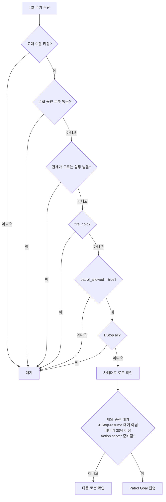
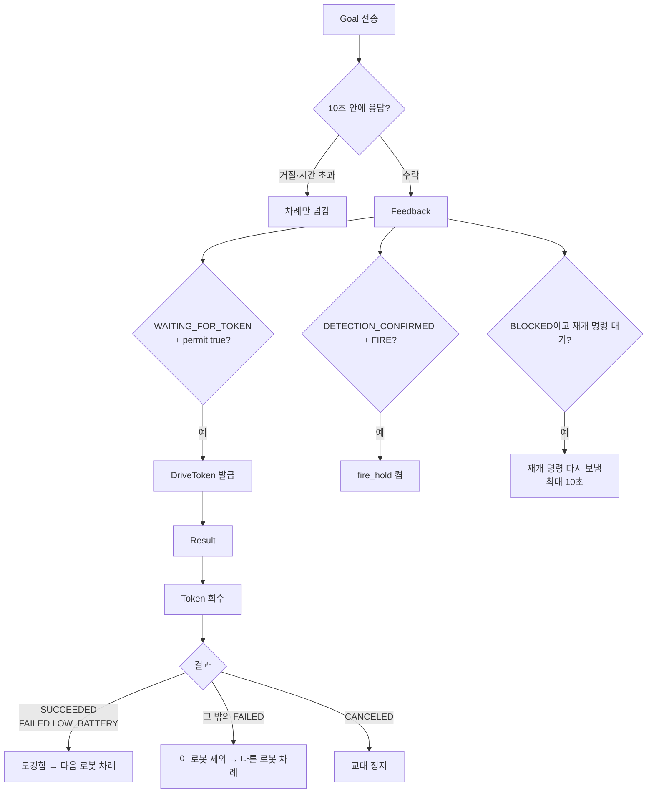
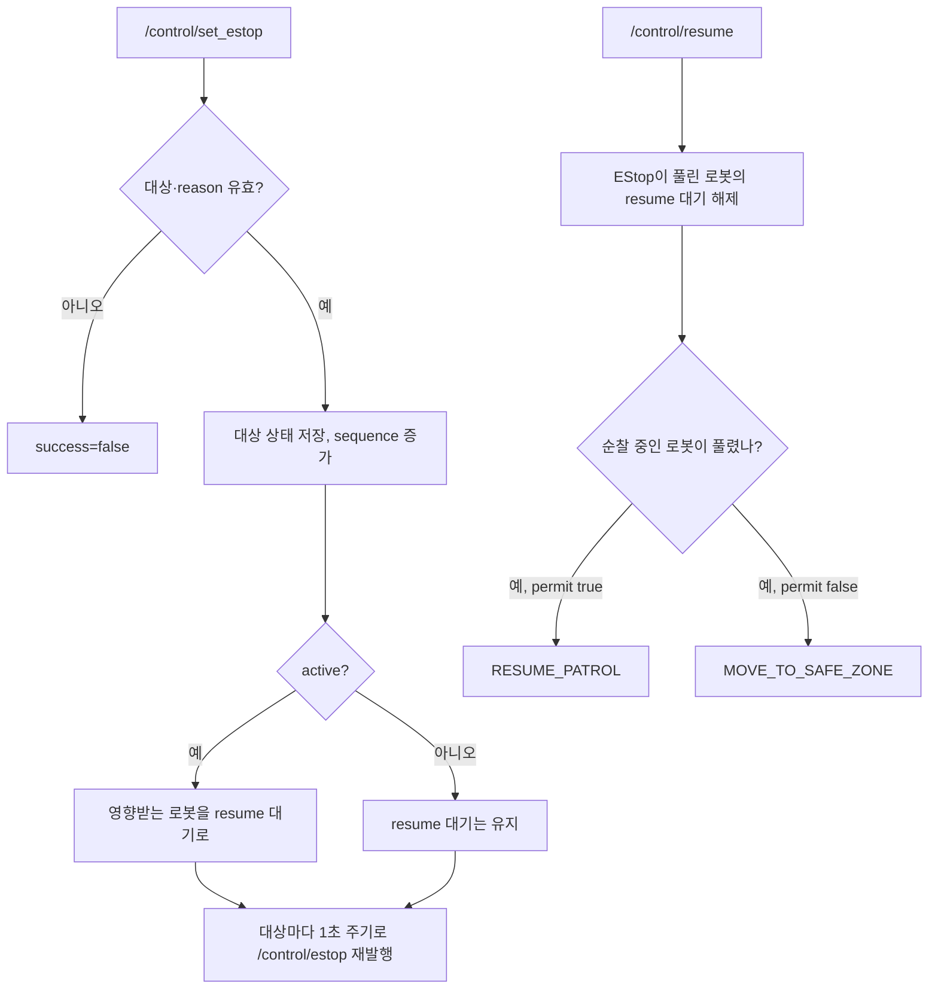

# 관제(Control Server) 기능 설계

> 기준일: 2026-09-13 · 계약: `patrol_interfaces 2.1.0` · 패키지: `patrol_control 0.3.0`
>
> 실행 위치: PC 3

공용 타입·토픽·서비스 필드는 [interfaces.md](interfaces.md)를 따른다. 이 문서는
`src/patrol_control`이 맡는 판단과 코드 흐름을 설명한다.

## 1. 하는 일

- `robot1`, `robot6` Patrol Action Client, 한 번에 한 로봇만 순찰
- 교대 순찰: 도킹을 마친 로봇 다음 차례의 로봇을 자동 출발
- 로봇별 DriveToken 발행(5 Hz, lease 1초), 순찰 중인 로봇에만 권한 부여
- CCTV `patrol_allowed` 변화에 따라 `MOVE_TO_SAFE_ZONE` / `RESUME_PATROL`
- 화재 확정 시 `fire_hold`
- EStop 단일 발행자(Safety Arbiter)
- 배터리에 따른 출발 제한과 충전 대기
- 도킹 실패 등으로 도크에 없는 로봇을 교대 순서에서 제외
- 관제를 다시 띄웠을 때 남아 있는 임무 정리와 상태 복원
- 운영자 명령을 터미널 ROS 서비스로 받음

## 2. 파일 구성

| 파일 | 내용 |
|---|---|
| `patrol_control/control_core.py` | ROS 없는 상태 머신 `ControlCore`. 출발 판단, Token, permit 명령, fire hold, EStop, 교대, 배터리, 상태 저장 형식 |
| `patrol_control/patrol_control_node.py` | ROS 노드 `PatrolControlNode`. Action Client, 발행·구독, 운영 서비스, 타이머, 남은 임무 감시 |
| `patrol_control/control_state.py` | `~/.ros/patrol_control/state.json` 읽기·쓰기(원자적 저장) |

## 3. 출발 판단



## 4. 임무 한 번의 흐름



- `FAILED(LOW_BATTERY)`는 도킹을 마친 것이므로 다음 로봇에 넘기고, 그 로봇은 배터리 80%가 될 때까지 충전 대기로 둔다.
- 제외된 로봇은 운영자가 `/control/start_patrol`을 호출하면 다시 순서에 들어간다.
- 실행 중 AMR Action server가 10초 넘게 사라지면 그 임무를 실패로 보고 관제가 모르는 임무로 표시한다.

## 5. permit과 명령

- `patrol_allowed` 값이 바뀔 때만 명령을 만든다. 같은 값 반복은 무시한다.
- 순찰 중인 로봇이 Goal 수락 상태일 때만 보낸다: false → `MOVE_TO_SAFE_ZONE`, true → `RESUME_PATROL`.
- 그 로봇에 EStop이 걸려 있거나 resume 대기 중이면 명령을 보내지 않는다. 그때의 명령은 `/control/resume`에서 정한다.

## 6. EStop



- 대상은 `robot1`, `robot6`, `all`이다. 세 대상의 현재 상태를 0.33초 간격으로 하나씩 발행해 대상마다 1초 주기가 된다.
- sequence는 관제를 다시 띄워도 줄어들지 않게 현재 시각(ms)보다 작아지지 않도록 한다.
- EStop 중에도 DriveToken은 유지한다. EStop과 Token은 AMR에서 각각 따로 막는다.

## 7. 관제가 모르는 임무

관제를 다시 띄우면 AMR에는 이전 관제가 보낸 임무가 남아 있을 수 있다.

- 각 로봇의 `/{robot}/patrol_action/_action/status`를 구독해, 관제가 보낸 Goal UUID가 아닌 실행 중인 Goal을 찾는다.
- 찾으면 `CancelGoal`(전체 취소)을 보내고 5초마다 다시 보낸다.
- 그 임무가 끝났거나 로봇이 사라진 것이 확인될 때까지 아무 로봇도 출발시키지 않는다.
- 시작 후 10초는 확인 시간으로 출발을 미룬다.
- 이전에 순찰 중이던 로봇은 도크에 없을 수 있으므로, 임무가 끝나기 전에는 `/control/start_patrol`로도 순서에 넣지 않는다.

## 8. 상태 저장

`~/.ros/patrol_control/state.json`에 저장하는 값: `fire_hold`와 화재 사건 ID, 교대 켜짐,
제외된 로봇, 충전 대기, resume 대기, EStop 상태와 sequence, 순찰 중이던 로봇, 다음 차례.
상태가 바뀔 때마다 임시 파일에 쓰고 바꿔 넣는다.

## 9. 실행

```bash
ros2 run patrol_control patrol_control_node
ros2 run patrol_control patrol_control_node --ros-args -p auto_start:=true
```

| 파라미터 | 기본값 | 의미 |
|---|---|---|
| `robot_ids` | `[robot1, robot6]` | 관리할 로봇과 교대 순서 |
| `initial_robot_id` | 첫 번째 로봇 | 처음 출발할 로봇 |
| `auto_start` | `false` | 시작하자마자 교대 순찰을 켬 |
| `token_publish_hz` | `5.0` | DriveToken 발행 주기 |
| `token_lease_seconds` | `1.0` | DriveToken lease |

운영 서비스는 [interfaces.md 3.2절](interfaces.md#32-관제-운영-서비스)을 따른다.

## 10. 시험

```bash
cd src/patrol_control && python3 -m pytest -q test
```

- `test_control_core.py`: Goal 조건, Token 발급 순서와 sequence, permit 명령 중복 방지, fire hold, Token 회수
- `test_patrol_control_node.py`: 교대·도킹 실패 제외·배터리 충전 대기, EStop과 resume, 관제가 모르는 임무 취소와 상태 복원, Goal 응답 시간 초과, 서버 사라짐, 재개 명령 재전송
