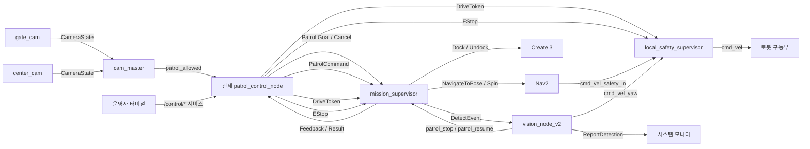

# 공용 ROS 2 인터페이스

> 기준일: 2026-09-13
>
> 공용 패키지: `patrol_interfaces 2.1.0` · AMR 내부 패키지: `patrol_amr_interfaces`

이 문서는 관제(Control Server), AMR, CCTV 비전, 시스템 모니터 사이의 ROS 2
인터페이스 기준이다. 2.1.0은 2.0.0에 `SetEStop` 서비스와 Patrol Result
`REASON_LOW_BATTERY=11`을 더하고, 어느 노드도 쓰지 않는 `DetectionEvidence`와
`MissionExecutionEvent`를 뺀 것이다. 남은 타입의 필드는 2.0.0과 같다.

## 1. 공통 규칙

- `{robot}`은 `robot1` 또는 `robot6`이다.
- 로봇별 인터페이스는 `/{robot}/...` 아래에 둔다.
- 메시지의 `robot_id`는 토픽 namespace와 일치해야 한다.
- 좌표는 `map` 좌표계를 사용한다. 두 로봇은 같은 지도(`final_project_map`)를 쓰며
  지도 원점은 `robot1` 도크다.
- 외부에서 순찰 Action을 호출하는 것은 관제뿐이다.
- AMR의 `mission_supervisor`가 Nav2와 Create 3 Action을 내부적으로 사용한다.
- Goal이 수락되어도 유효한 DriveToken을 받기 전에는 주행하지 않는다.
- 바퀴로 가는 최종 속도(`/{robot}/cmd_vel`)는 AMR의 `local_safety_supervisor`만 발행한다.

## 2. 전체 구성



```text
순찰 시스템
├── 관제 patrol_control_node (PC 3)
│   ├── Action Client  /{robot}/patrol_action
│   ├── Publisher      /{robot}/patrol_command
│   ├── Publisher      /{robot}/drive_token
│   ├── Publisher      /control/estop
│   ├── Subscriber     /vision/cctv/patrol_allowed
│   ├── Subscriber     /{robot}/battery_state
│   ├── Subscriber     /{robot}/patrol_action/_action/status
│   └── Service Server /control/start_patrol · cancel_patrol · clear_fire_hold · set_estop · resume
├── AMR /{robot} (PC 1 · PC 2)
│   ├── mission_supervisor
│   │   ├── Action Server  patrol_action
│   │   ├── Subscriber     patrol_command · drive_token · /control/estop
│   │   ├── Subscriber     amcl_pose · dock_status · battery_state · patrol_resume
│   │   ├── Service Server patrol_stop
│   │   └── Action Client  detect_event · navigate_to_pose · spin · dock · undock
│   ├── local_safety_supervisor
│   │   ├── Subscriber     drive_token · /control/estop · cmd_vel_safety_in · cmd_vel_yaw
│   │   └── Publisher      cmd_vel
│   └── vision_node_v2
│       ├── Action Server  detect_event
│       ├── Publisher      cmd_vel_yaw · patrol_resume
│       ├── Service Client patrol_stop · /system_monitor/report_detection
│       └── Subscriber     oakd/rgb/image_raw/compressed · amcl_pose · odom
├── CCTV 비전 (PC 4)
│   ├── gate_cam      → /vision/cctv/gate_event
│   ├── center_cam    → /vision/cctv/center_event
│   └── cam_master    → /vision/cctv/patrol_allowed
└── 시스템 모니터 (PC 3, 읽기 전용)
    └── Service Server /system_monitor/report_detection
```

## 3. 인터페이스 목록

### 3.1 공용 (`patrol_interfaces`)

| 이름 | 타입 | 송신 → 수신 | 용도 |
|---|---|---|---|
| `/{robot}/patrol_action` | `action/Patrol` | 관제 ↔ `mission_supervisor` | 순찰 시작, 진행 상태, 결과, 취소 |
| `/{robot}/patrol_command` | `msg/PatrolCommand` | 관제 → `mission_supervisor` | 안전구역 이동과 순찰 재개 |
| `/{robot}/drive_token` | `msg/DriveToken` | 관제 → `local_safety_supervisor`, `mission_supervisor` | 주행 권한 부여·갱신·회수 |
| `/control/estop` | `msg/EStop` | 관제 → `local_safety_supervisor`, `mission_supervisor`, 시스템 모니터 | 비상정지 상태 |
| `/control/set_estop` | `srv/SetEStop` | 운영자 → 관제 | 비상정지 걸기·해제 요청 |
| `/system_monitor/report_detection` | `srv/ReportDetection` | `vision_node_v2` → 시스템 모니터 | 확정 사건과 증거 사진 저장 |
| `/vision/cctv/gate_event` | `msg/CameraState` | `gate_cam` → `cam_master` | 차량 진입·이탈 |
| `/vision/cctv/center_event` | `msg/CameraState` | `center_cam` → `cam_master` | 차량 주차·출차 |
| `/vision/cctv/patrol_allowed` | `std_msgs/Bool` | `cam_master` → 관제 | 순찰 허용 조건 |

### 3.2 관제 운영 서비스

운영자는 관제 PC 터미널에서 ROS 서비스로 명령한다.

| 서비스 | 타입 | 동작 |
|---|---|---|
| `/control/start_patrol` | `std_srvs/Trigger` | 교대 순찰 시작. 순서에서 빠진 로봇도 다시 넣는다 |
| `/control/cancel_patrol` | `std_srvs/Trigger` | 진행 중인 순찰 취소, 교대 정지 |
| `/control/clear_fire_hold` | `std_srvs/Trigger` | 화재 보류 해제 |
| `/control/set_estop` | `patrol_interfaces/srv/SetEStop` | EStop 걸기·해제 |
| `/control/resume` | `std_srvs/Trigger` | EStop 해제 뒤 멈춰 있는 로봇 재개 |

```bash
ros2 service call /control/start_patrol std_srvs/srv/Trigger
ros2 service call /control/set_estop patrol_interfaces/srv/SetEStop \
  "{target_robot_id: robot1, active: true, reason: 1}"
ros2 service call /control/set_estop patrol_interfaces/srv/SetEStop \
  "{target_robot_id: robot1, active: false, reason: 1}"
ros2 service call /control/resume std_srvs/srv/Trigger
```

### 3.3 AMR 내부 (같은 로봇 안에서만 사용)

| 이름 | 타입 | 송신 → 수신 | 용도 |
|---|---|---|---|
| `/{robot}/patrol_stop` | `std_srvs/SetBool` (`data=false`) | `vision_node_v2` → `mission_supervisor` | 후보를 봤으니 순찰을 멈춰 달라는 요청 |
| `/{robot}/detect_event` | `patrol_amr_interfaces/action/DetectEvent` | `mission_supervisor` → `vision_node_v2` | 정렬·검증 요청과 확정 결과 |
| `/{robot}/patrol_resume` | `std_msgs/Bool` | `vision_node_v2` → `mission_supervisor` | 저장 결과를 받았으니 재개해도 된다는 알림 |
| `/{robot}/cmd_vel_safety_in` | `geometry_msgs/TwistStamped` | Nav2(collision_monitor, docking_server) → `local_safety_supervisor` | Nav2 주행 후보 |
| `/{robot}/cmd_vel_yaw` | `geometry_msgs/TwistStamped` | `vision_node_v2` → `local_safety_supervisor` | 정렬 회전 후보 |
| `/{robot}/cmd_vel` | `geometry_msgs/TwistStamped` | `local_safety_supervisor` → 로봇 구동부 | 최종 속도 |

## 4. Patrol Action

### 4.1 Goal

```text
string command_id
string robot_id
```

- 각 AMR은 `config/site.yaml`에 등록된 순찰 경로를 실행한다.
- `robot_id`가 노드 namespace와 다르거나 이미 실행 중인 순찰이 있으면 AMR이 Goal을 거절한다.
- Goal이 수락되어도 AMR은 `WAITING_FOR_TOKEN`을 먼저 보고한다.

### 4.2 Feedback

```text
uint8 task_state
string current_waypoint_id
string last_command_id
uint8 command_status
bool token_valid
uint32 accepted_token_sequence
geometry_msgs/PoseStamped current_pose
string event_id
uint8 event_type
```

`task_state`:

```text
WAITING_FOR_TOKEN     = 1
UNDOCKING             = 2
INITIAL_POSE_READY    = 3
PATROLLING            = 4
MOVING_TO_SAFE_ZONE   = 5
DETECTION_PROCESSING  = 6
DETECTION_CONFIRMED   = 7
RESUMING              = 8
DOCKING               = 9
BLOCKED               = 10
WAYPOINT_REACHED      = 11
```

`command_status`: `NONE=0`, `ACCEPTED=1`, `EXECUTING=2`, `REJECTED=3`

`event_type`: `FIRE=1`, `LEAK=2`, `OBSTACLE=3`

- `INITIAL_POSE_READY`에서는 `current_pose`가 유효하다.
- `WAYPOINT_REACHED`에서는 `current_waypoint_id`가 유효하다. 관제는 수신 시각을 방문 시각으로 쓴다.
- `DETECTION_CONFIRMED`에서는 `event_id`와 `event_type`이 유효하다.
- `BLOCKED`는 EStop 또는 DriveToken 회수·만료로 멈춘 상태다.
- 명령 처리 결과는 `last_command_id`와 `command_status`로, 최신 Token 수신 여부는
  `token_valid`와 `accepted_token_sequence`로 보고한다.

### 4.3 Result

```text
uint8 outcome
uint16 reason_code
string reason
```

`outcome`: `SUCCEEDED=0`, `FAILED=1`, `CANCELED=2`

`reason_code`:

```text
CONTROL_CANCELED  = 1
SAFETY_STOP       = 2
TOKEN_EXPIRED     = 3
INVALID_COMMAND   = 4
NAVIGATION_FAILED = 5
OBSTACLE_BLOCKED  = 6
LOCALIZATION_LOST = 7
DOCKING_FAILED    = 8
TIMEOUT           = 9
INTERNAL_ERROR    = 10
LOW_BATTERY       = 11   # 2.1.0 추가: 배터리 부족으로 귀환·도킹을 마침
```

- `SUCCEEDED`는 순찰을 마치고 자기 도크에 도킹했다는 뜻이다. 건너뛴 경유지가 있으면 `reason`에 적는다.
- `FAILED`와 `CANCELED`에서는 `reason_code`를 설정한다.
- 관제의 취소는 ROS 2 Action Cancel을 사용한다.

### 4.4 정상 순서

```text
Goal 수락 → WAITING_FOR_TOKEN → (DriveToken) → token_valid=true
→ UNDOCKING → INITIAL_POSE_READY(current_pose) → PATROLLING
→ WAYPOINT_REACHED 반복 → DOCKING → Result
```

## 5. PatrolCommand

```text
std_msgs/Header header
string command_id
string robot_id
uint8 command
```

- `command`: `MOVE_TO_SAFE_ZONE=1`, `RESUME_PATROL=2`
- `command_id` 형식: `cmd-<robot_id>-<command>-<sequence>`
- 같은 명령을 다시 보낼 때는 같은 `command_id`를 쓰고, AMR은 이미 처리한 ID를 다시 실행하지 않는다.
- 실행 중인 Patrol Action을 끝내지 않고 진행 상태만 바꾼다.
- 처리 결과는 Patrol Feedback으로 돌아온다.

## 6. DriveToken

```text
std_msgs/Header header
string token
string holder_robot_id
builtin_interfaces/Duration lease_duration
uint32 sequence
```

- 관제는 로봇마다 5 Hz로 발행하고 lease는 1초다(파라미터로 바꿀 수 있다).
- `holder_robot_id`는 토픽의 `{robot}`과 일치해야 한다.
- `sequence`는 발행할 때마다 증가하며, 과거 sequence는 폐기한다.
- 빈 `token`은 권한 회수다.
- Token은 주행 권한이지 주행 명령이 아니다. Token만으로 순찰을 시작하지 않는다.
- Token이 없거나 만료되면 `local_safety_supervisor`가 0 속도를 낸다.
- 한 번에 Token을 가진 로봇은 하나뿐이다.
- QoS: BEST_EFFORT / VOLATILE / KEEP_LAST

## 7. ReportDetection Service

`/system_monitor/report_detection` — 시스템 모니터가 서버, `vision_node_v2`가 클라이언트다.

Request:

```text
string robot_id
string event_id
builtin_interfaces/Time detected_at
geometry_msgs/Point position
uint8[] image
uint8 event_type          # FIRE=1, LEAK=2, OBSTACLE=3
```

Response:

```text
uint8 status              # STORED=0, DUPLICATE=1, REJECTED=2
string detail
```

- `event_id`는 소문자 UUID v4이며 Patrol Feedback의 `event_id`와 같은 값이다.
- `position`은 `map` 좌표계이고 `z=0`이다.
- `image`는 JPEG 또는 PNG 원본이며 최대 1 MiB다.
- 응답을 받지 못했을 때만 같은 `event_id`와 같은 내용으로 다시 보낸다(최대 3번).
- 같은 `event_id`에 다른 내용을 보내면 `REJECTED`다.

## 8. CCTV 차량 상태

`CameraState`:

```text
std_msgs/Header header
string event_id
string camera_id
string source_session_id
uint64 source_sequence
uint8 state               # UNKNOWN=0, ENTERING=1, EXITED=2, PARKED=3, EXITING=4
float32 confidence
```

- `/vision/cctv/gate_event`는 `gate_cam`의 `ENTERING`, `EXITED`만 받는다.
- `/vision/cctv/center_event`는 `center_cam`의 `PARKED`, `EXITING`만 받는다.
- `cam_master`는 두 상태를 종합해 `/vision/cctv/patrol_allowed`를 바뀔 때 즉시, 그리고 5 Hz로 발행한다.
- `patrol_allowed`가 false로 바뀌면 관제가 `MOVE_TO_SAFE_ZONE`, true로 바뀌면 `RESUME_PATROL`을 보낸다.
- `patrol_allowed`는 주행 명령이 아니라 허용 조건이다.

## 9. EStop

`EStop` (토픽 `/control/estop`):

```text
std_msgs/Header header
string target_robot_id    # robot1 / robot6 / all
bool active
uint8 reason
uint64 sequence
```

`SetEStop` (서비스 `/control/set_estop`, 2.1.0 추가):

```text
string target_robot_id    # robot1 / robot6 / all
bool active
uint8 reason
---
bool success
string message
```

`reason`: `0 UNKNOWN`, `1 OPERATOR`, `2 COMMUNICATION`, `3 TOKEN`, `4 OBSTACLE`,
`5 KEEPOUT_FAILURE`, `6 SYSTEM_FAULT`

- 발행자는 관제 하나다(Safety Arbiter). 대상(`robot1`, `robot6`, `all`)마다 현재 상태를 1초 주기로 다시 발행한다.
- QoS: RELIABLE / TRANSIENT_LOCAL / KEEP_LAST(1)
- `active=true`는 sequence와 상관없이 바로 적용한다. AMR은 즉시 정지하고 진행 중인 주행·도킹·감지를 취소한 뒤 `BLOCKED`를 보고한다.
- `active=false`는 sequence가 직전 값보다 클 때만 적용한다.
- 해제만으로는 다시 움직이지 않는다. 운영자가 `/control/resume`을 호출해야 관제가 재개 명령을 보낸다.
- AMR은 3초 동안 EStop 프레임을 받지 못하면 연결이 끊긴 것으로 보고 바퀴 출력을 막는다.

## 10. AMR 내부 DetectEvent (`patrol_amr_interfaces`)

```text
# Goal
string detection_id       # UUID v4, Feedback.event_id · ReportDetection.event_id와 같음
uint8 event_type
float32 min_confidence
---
# Result
bool confirmed
string robot_id
geometry_msgs/PoseStamped current_pose
uint8 event_type
float32 average_confidence
builtin_interfaces/Time event_time
---
# Feedback
uint8 ALIGNING=1
uint8 VERIFYING=2
uint8 state
float32 confirm_elapsed
float32 current_confidence
float32 average_confidence
```

같은 로봇의 `mission_supervisor`와 `vision_node_v2` 사이에서만 쓰며 다른 PC는 사용하지 않는다.

## 11. 패키지 구조

```text
src/patrol_interfaces/          (2.1.0)
├── action/Patrol.action
├── msg/
│   ├── PatrolCommand.msg
│   ├── DriveToken.msg
│   ├── EStop.msg
│   └── CameraState.msg
└── srv/
    ├── ReportDetection.srv
    └── SetEStop.srv

src/patrol_amr_interfaces/
└── action/DetectEvent.action
```

모든 PC는 같은 Git commit의 인터페이스 패키지를 빌드한다. `patrol_interfaces`의
소스와 설치 타입은 `python3 scripts/verify_interface_v1.py`로 확인한다.
