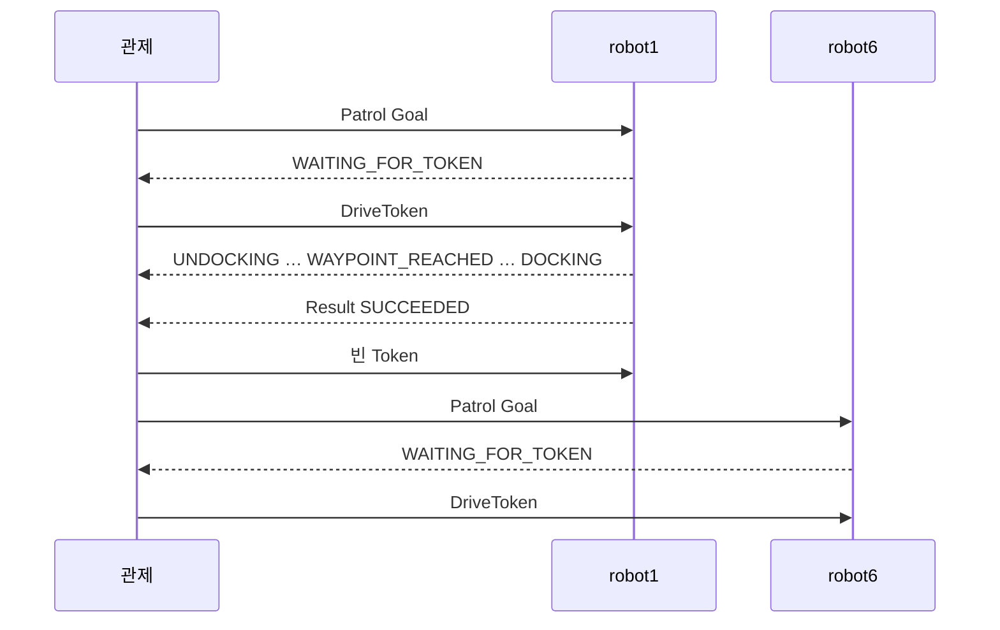
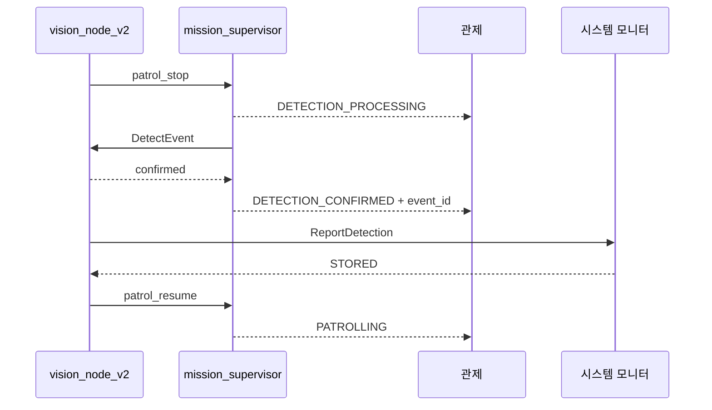

# 시스템 시나리오

> 기준일: 2026-09-13 · 계약: `patrol_interfaces 2.1.0`

상황별로 관제·AMR·CCTV·시스템 모니터가 어떻게 움직이는지 정리한다. 필드와 QoS는
[interfaces.md](interfaces.md), 노드 안의 흐름은 [control_server.md](control_server.md)와
[amr.md](amr.md)를 따른다.

## 1. 교대 순찰

운영자가 `/control/start_patrol`을 호출하면 교대 순찰이 시작된다(관제를
`auto_start:=true`로 띄우면 시작할 때 자동으로 켜진다).

관제가 로봇을 출발시키는 조건:

- 교대 순찰이 켜져 있다.
- 다른 로봇이 순찰 중이 아니다.
- `fire_hold`가 없다.
- CCTV `patrol_allowed=true`다.
- 전체 EStop(`all`)이 걸려 있지 않다.
- 관제가 모르는 임무가 AMR에 남아 있지 않다(7절).
- 대상 로봇이 순서에서 빠지지 않았고, 충전 대기가 아니며, EStop이 걸려 있지 않고,
  배터리가 30% 이상이다.

흐름:

1. 관제가 차례인 로봇에 Patrol Goal을 보낸다.
2. AMR은 Goal을 수락하고 `WAITING_FOR_TOKEN`을 보고한다.
3. 관제가 그 로봇에만 DriveToken을 발급한다.
4. AMR은 언도킹 → 초기 위치 설정(`INITIAL_POSE_READY`) → 경유지 WP1~WP6 → WP3 → WP7 → WP1 순찰
   (각 경유지에서 360° 회전, `WAYPOINT_REACHED`) → 자기 도크 앞 → 도킹 순으로 진행한다.
5. 도킹이 확인되면 `SUCCEEDED`를 돌려준다.
6. 관제는 Token을 회수하고 다음 로봇을 출발시킨다(`robot1` → `robot6` → `robot1` …).

두 로봇의 도크는 같은 지도에서 `robot1` (0, 0), `robot6` (0, −2.076)이다. 각 로봇은
자기 도크에서 출발해 자기 도크로 돌아온다.

## 2. 차량 진입과 순찰 재개

1. CCTV가 차량 진입(`ENTERING`)을 확정하면 `cam_master`가 `patrol_allowed=false`를 발행한다.
2. 관제는 순찰 중인 로봇에 `MOVE_TO_SAFE_ZONE`을 한 번 보낸다.
3. AMR은 멈추고 가장 가까운 안전구역으로 이동해 기다린다(`MOVING_TO_SAFE_ZONE`). Token은 유지한다.
4. 차량이 주차(`PARKED`)하거나 나가면(`EXITED`) `patrol_allowed=true`가 된다.
5. 관제가 `RESUME_PATROL`을 한 번 보낸다.
6. AMR은 `RESUMING` 후 멈췄던 단계부터 순찰을 이어 간다.

같은 permit 값이 반복해서 와도 명령은 다시 만들지 않는다. 순찰 중인 로봇이 없을 때
permit이 false면 새 로봇을 출발시키지 않는다.

## 3. 위험 요소 감지와 보고

1. `vision_node_v2`가 OAK-D 영상에서 화재·누수·적치물 후보(신뢰도 0.70 이상)를 본다.
2. 감지 노드가 `patrol_stop`으로 정지를 요청한다. AMR은 순찰 경로를 달리는 중에만 받는다.
3. AMR은 멈추고 `DETECTION_PROCESSING`을 보고한 뒤 감지 노드에 `DetectEvent`를 보낸다.
4. 감지 노드가 제자리 회전으로 대상을 화면 가운데에 맞추고(정렬), 1초 동안 신뢰도를
   다시 확인한다(검증).
5. 확정이면 AMR이 `DETECTION_CONFIRMED`와 `event_id`·`event_type`을 관제에 보고한다.
6. 감지 노드는 같은 `event_id`로 `/system_monitor/report_detection`에 사건과 사진을 보낸다.
   응답이 없으면 같은 내용으로 다시 보낸다.
7. 저장 결과(`STORED`, `DUPLICATE`, `REJECTED`)를 받으면 `patrol_resume`을 보내고 AMR이 순찰을 재개한다.
   거절됐거나 응답이 끝내 없으면 사진과 요청 내용을 로봇 PC에 남겨 사건을 잃지 않는다.
8. 확정되지 않으면 바로 재개한다. 같은 자리의 같은 종류 후보는 60초 동안 무시한다.

## 4. 화재 확정

- 관제가 `DETECTION_CONFIRMED + FIRE`를 받으면 `fire_hold`를 켠다.
- 지금 순찰 중인 로봇은 임무를 끝까지 마칠 수 있다(Token 유지).
- 임무가 끝난 뒤에는 운영자가 `/control/clear_fire_hold`로 풀기 전까지 새 순찰을 시작하지 않는다.
- `fire_hold`는 관제를 다시 띄워도 유지된다.

## 5. 비상정지(EStop)

1. 운영자가 `/control/set_estop`으로 대상(`robot1`, `robot6`, `all`)에 EStop을 건다.
2. 관제가 `/control/estop`으로 발행한다.
3. 대상 AMR의 `local_safety_supervisor`는 즉시 0 속도를 내고, `mission_supervisor`는
   진행 중인 주행·회전·도킹·감지를 취소하고 `BLOCKED`를 보고한다.
4. EStop을 해제해도 로봇은 움직이지 않는다.
5. 운영자가 `/control/resume`을 호출하면, 관제가 그때 permit에 맞는 명령을 보낸다
   (허용이면 `RESUME_PATROL`, 차량 이동 중이면 `MOVE_TO_SAFE_ZONE`).
6. AMR은 EStop 해제, 유효한 Token, 해제 뒤 받은 재개 명령이 모두 있을 때만 다시 움직인다.

EStop이 걸린 로봇은 resume 전까지 새 순찰에도 출발하지 않는다. 전체 EStop(`all`)이
걸려 있으면 어떤 로봇도 출발하지 않는다.

## 6. 주행 권한 회수

- DriveToken이 끊기거나 만료되면 `local_safety_supervisor`가 0 속도를 낸다.
- AMR은 멈추고 `BLOCKED`를 보고한다. Token이 돌아오면 이어서 진행한다.
- 30초 안에 돌아오지 않으면 `FAILED(TOKEN_EXPIRED)`로 끝낸다.

## 7. 경유지 이동 실패

- 경유지로 가지 못하면 한 번 더 시도한다.
- 그래도 안 되면 그 경유지를 건너뛰고 다음으로 간다. 건너뛴 경유지는 Result `reason`에 적는다.
- 연속으로 2개를 건너뛰면 남은 경로를 포기하고 바로 귀환·도킹한다.

## 8. 배터리 부족

- 순찰 중 배터리가 15% 아래로 떨어지면 AMR은 귀환·도킹하고 `FAILED(LOW_BATTERY)`로 끝낸다.
  안전구역에서 기다리는 중이면 `RESUME_PATROL`을 받은 뒤 귀환한다.
- 관제는 이것을 "도킹함"으로 보고 다음 로봇에 차례를 넘긴다.
- 배터리가 30% 아래인 로봇은 출발시키지 않고, 80% 이상이 될 때까지 충전 대기로 둔다.

## 9. 도킹

도킹 성공 기준: 도크 접속(`dock_status`)이 2초 이상 유지되고, 도킹 뒤 받은 배터리
상태가 충전 중 또는 완충이다.

| 시도 | 동작 |
|---|---|
| 1 | 도크 앞에서 도킹 |
| 2 | 도크 앞으로 다시 접근해 도킹 (접속은 됐는데 충전이 안 되면 먼저 빠져나온다) |
| 3 | 제자리 360° 회전으로 위치를 다시 잡고 재접근해 도킹 |

- 세 번 모두 실패하면 자기 도크 앞에 서서 `FAILED(DOCKING_FAILED)`로 끝낸다.
- 도크 앞까지 가지 못하면 가장 가까운 안전구역에, 그것도 안 되면 그 자리에 선다.
- 관제는 그 로봇을 교대 순서에서 빼고 다른 로봇으로 순찰을 이어 간다.
- 운영자가 로봇을 확인한 뒤 `/control/start_patrol`을 호출하면 다시 순서에 들어간다.

## 10. 취소

- 운영자가 `/control/cancel_patrol`을 호출하면 관제는 Token을 먼저 회수하고 Action Cancel을 보낸다.
- AMR은 진행 중인 동작을 모두 취소하고 정지한 뒤 `CANCELED(CONTROL_CANCELED)`를 돌려준다.
- 교대 순찰도 멈춘다. 다시 시작하려면 `/control/start_patrol`을 호출한다.

## 11. 관제 재시작

- 관제는 교대 상태, 순서에서 빠진 로봇, 충전 대기, `fire_hold`, EStop 상태를
  `~/.ros/patrol_control/state.json`에 저장하고 다시 띄울 때 불러온다.
- 다시 띄우면 처음 10초 동안 AMR에 관제가 모르는 임무가 남아 있는지 확인한다.
- 남아 있으면 그 임무를 취소하고, 끝난 것이 확인될 때까지 아무 로봇도 출발시키지 않는다.
- 통신이 복구되거나 permit이 돌아온 것만으로는 새 Goal을 만들지 않는다. 교대 순찰이
  켜져 있고 위 출발 조건을 모두 만족할 때만 출발시킨다.

## 12. CCTV 상태

| 카메라 | 상태 | `patrol_allowed` |
|---|---|---|
| (시작) | — | true |
| `gate_cam` | `ENTERING` | false |
| `center_cam` | `PARKED` | true |
| `center_cam` | `EXITING` | false |
| `gate_cam` | `EXITED` | true |

CCTV는 AMR에 직접 주행 명령을 보내지 않는다. 자세한 기준은 [vision.md](vision.md)를 따른다.

## 13. 시스템 모니터

- `ReportDetection`을 받아 저장하고 `STORED`, `DUPLICATE`, `REJECTED`로 응답한다.
- Patrol Action 피드백·상태, 배터리, EStop, CCTV 상태와 영상을 구독해 읽기 전용으로 보여 준다.
- Goal, PatrolCommand, DriveToken, EStop을 발행하지 않는다.
